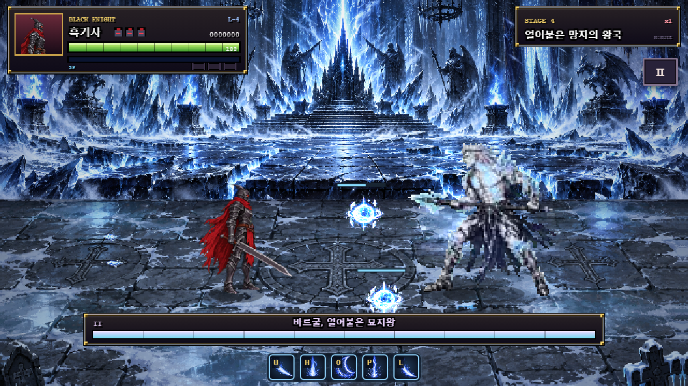

# v1.36 바르굴 — 구슬 독립 AI 변경

작성일: 2026-10-20 (Asia/Seoul). 플레이어를 중심으로 도는 구슬을 체력이 있는 독립 소환 적으로 변경했다. [최신 결정 사항](boss4_vargul.md), [실행 결과](../artifacts/vargul-1.36/orb-ai/results.json), [전용 시험](../tests/vargul-orb-ai.cjs).

## 적용한 동작

| 항목 | 변경 후 |
| --- | --- |
| 소환 수 | 2개 |
| 체력 | 각30, 개별 체력바 |
| 이동 | 플레이어 추적·근접 시 후퇴·거리 유지·측면 이동·상하 부유·서로 분리 |
| 이동 상한 | x0.9 / 깊이0.55 월드 px/틱, 부드러운 가감속 |
| 목표 사격 거리 | x110±24 월드 px |
| 공격 | 각자 반짝인 뒤 플레이어를 조준해 빙결 마탄 발사 |
| P1 | 각200틱마다1발, 두 구슬의 첫 예고를100틱 차이로 분산, 예고20틱, 피해8 |
| P2 | 각150틱마다2발, 두 구슬의 첫 예고를75틱 차이로 분산, 예고17틱, 피해10 |
| 파괴 | 공격의 실제 피해로 HP0이 되면 얼음 파괴 효과, 보스 그로기+20 |
| 수명 | 자동 소멸 없음. 전환·보스 사망 시 정리 |
| 재소환 | 하나라도 살아 있으면 금지. 모두 깨진 뒤720틱 쿨타임 |

별도 체력값이 지정되지 않아 HP30으로 설정했다. 기본 일반 공격10 기준 세 번에 깨지고, 강화 공격·강한 기술은 더 큰 피해를 준다. 기존의 두 번 피격 파괴·600틱 자동 소멸·플레이어 중심 궤도는 제거했다. 같은 한 번의 공격이 매 틱 중복 적중하지 않으며 피격 무적10틱은 유지한다.

사격은 각 구슬의 자체 타이머로 처리한다. 기존 한 쌍의 평균 사격 간격100/75틱을 유지하도록 개별 간격을200/150틱으로 나눴다. 바렐이 쓰러졌거나 사망한 동안에는 사격하지 않는다. 마탄은 발사 순간을 조준하고 이후 유도하지 않는다. 새 빙결 상태이상을 추가하지 않고 기존 얼음 마탄의 피해·피격 처리를 사용한다.

## 실행 검증

실제 게임 JavaScript를 격리 Chrome에서 실행했다. 이동·사격은 실제 `update()`로 진행하고 공격별 피해는 제품의 공격·기술·투사체 함수를 호출했다.

- 플레이어 위치를 급히 바꿔도 구슬은 이동 속도 상한 안에서만 움직이며 함께 순간이동하지 않는다.
- 1,200틱 이상 실행해도 두 구슬이 생존하고 무대 범위를 벗어나지 않는다.
- P1/P2 각각500틱 동안 양쪽 구슬 모두 사격했다. 총 마탄 수는4/12발이었다. 무적을 끈 별도 실행에서도 실제 적중 피해가 각8/10인 것을 확인했다.
- 일반 공격10, 강화 일반 공격15, 기술18, 필살기14, 뇌격80, 일반 검기8, 적색 검기의 개별 피해가 구슬 체력에 적용된다.
- 같은 공격의 중복 적중·피격 무적을 검사했다. 일반 공격 세 번으로 파괴되고 그로기20이 지급된다.
- 하나만 파괴한 상태에서는 일반 AI와 소환 이벤트 모두 추가 소환을 막는다. 마지막 파괴 뒤719틱에는 쿨타임1,720틱 뒤에는 다시 소환 가능하다.
- 보스의 페이즈 전환·사망 시 구슬을 정리한다.
- 기존 전용14개 페이즈별 기술·반복 키·등장·전환·사망 회귀 통과. [전용 회귀](../artifacts/vargul-1.36/orb-ai/regression/results.json).
- 전체72개 보스 패턴/페이즈·1–5스테이지 클리어 회귀 통과. Console/Log 오류 수집을 켰으며 콘솔 오류·브라우저 예외0. [전체 로그](../artifacts/vargul-1.36/orb-ai/full-regression.log).



## 변경 파일과 범위

- `vargul-data.js`: HP·독립 AI 이동·사격 수치.
- `vargul-runtime.js`: 소환 적 생성, 독립 이동·사격, 실제 피해·파괴, 체력바·디버그 조준선.
- `game.js`: 일반 공격·기술·필살기·뇌격·검기의 실제 피해량 연결.
- `tests/vargul-orb-ai.cjs`, `tests/vargul.cjs`, `tests/regression.cjs`: 새 동작 시험과 변경된 기대값·진입점.
- 기준 문서·README·패치 노트: 최신 구슬 동작과 공략 반영.

기존 아트를 재사용했고 `vargul-art.js`·프레임 메타데이터 해시는 동일하다. 구슬 소환 후R36과 다른 보스 기술은 유지했다. 이전 단계의 궤도 구슬 회피·반격 측정은 현재 구슬의 측정값으로 사용하지 않는다. 이번 변경에서 처치 시간·성능은 다시 측정하지 않았다.

재현(PowerShell, 새 터미널):

```powershell
$env:VARGUL_ORB_AI='1'
node tests/regression.cjs
Remove-Item Env:VARGUL_ORB_AI
$env:VARGUL_SUITE='1'
$env:VARGUL_ARTIFACT_DIR='artifacts/vargul-1.36/orb-ai/regression'
node tests/regression.cjs
Remove-Item Env:VARGUL_SUITE
$env:VARGUL_CAPTURE_CONSOLE='1'
node tests/regression.cjs
```
