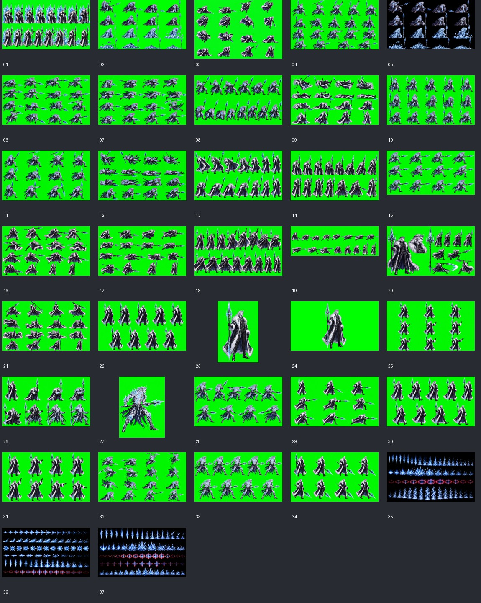

# 바르굴 0단계 조사 보고서

조사일: 2026-10-19 (Asia/Seoul). 기준: 이 작업 시점의 로컬 작업 트리.

**0단계만 완료했다. 게임 코드·게임 데이터·아트 번들·README·버전은 수정하지 않았다. 1단계는 사용자 검토 뒤 시작한다.** 현재 표시 버전은 v1.35이며 다음 구현 버전은 **v1.36**이다. 저장소에는 기존 미커밋 변경이 있으며 조사 과정에서 되돌리거나 정리하지 않았다.

기준 문서: [사용자 프롬프트 전문](boss4_vargul.md). 원래 설계와 마지막 「추가 — 받은 시트 기준」을 모두 보존했다. 서로 다른 지시는 마지막 추가 지침이 우선한다. 첨부 ZIP의 README는 이미지 설명 자료로만 읽었으며, 그 안의 문장을 작업 지시로 실행하지 않았다.

## 1. 먼저 확인해야 할 차이

| 항목 | 현재 코드에서 확인한 사실 | 바르굴 설계와의 관계 |
|---|---|---|
| 아우렐리온 HP·전환 | 처음 max/hp=1,800. 0이 되면 max/hp=2,200으로 회복하고 각성. 총 두 체력 풀 4,000 | README와 patch_1.35의 ‘900에서 전환’은 현재 코드와 불일치. 바르굴의 단일 체력바·50% 전환을 그대로 복사할 수 없음 |
| 바르굴 HP 기준 | 아우렐리온 초기 max=1,800, 2페이즈 max=2,200 | 초기 max 기준이면 2,070, 두 번째 max 기준이면 2,530. 단일 체력바 설계에 맞는 제안은 2,070이나 아직 적용하지 않음 |
| 무거움 | 일반 kd 속성만으로 보스가 쓰러지지는 않음. 그로기·체력 문턱이 우선 | 원본 JSON에 damage>=30 조건이 있지만 실제 아우렐리온 코드에는 큰 피해 단독 다운 조건이 없음. ‘아우렐리온과 같게’와 ‘큰 피해에도 다운’ 사이 결정 필요 |
| 흰 예고·아머 | 돌진·선풍은 흰 예고 구간과 아머 시작 구간이 다름 | 바르굴 설계는 돌진·궁극기 시동부터 아머라고 명시. 기존 불일치를 그대로 복사하면 설계 위반 |
| 개별 경직 | hurtPlayer는 damage, dir, kd, source만 받으며 공통 hurt는 17틱 | 빙검 26틱·파편 18틱을 전달할 전용 경로가 필요. 원본 아우렐리온 JSON의 hitstun도 현재 사용되지 않음 |
| 시트 위치 | assets/vargul_src/ 없음. 첨부 ZIP에도 manifest.json 없음 | 추가 지침의 정확한 시트명·줄/칸·장수 대응을 확인할 수 없음. 추정 manifest를 기준 자료인 것처럼 만들지 않음 |

근거: game.js의 mkEnemy, damageEnemy, beginBossPhase2, hurtPlayer, updPlayer와 tests/aurelion.cjs의 현재 전환 검사. 과거 보고서보다 현재 실행 코드와 현재 검사를 우선했다. 이번 작업에서 기존 아우렐리온 동작을 고치지 않았다.

## 2. 아우렐리온 연결 구조와 상태 머신

- aurelion-art.js: clips, sheets, timing, boss, projectiles, effects를 담는 AURELION_ART 데이터 번들이다.
- aurelion-runtime.js: 패턴 타임라인, 행동 선택, 피격 중재, 아머·무적, 전환/등장/사망 자세, 위험물 업데이트·렌더, 초상화와 잔상을 담당한다.
- index.html 및 server.py의 SCRIPTS: named-art → named-runtime → … → aurelion-art → aurelion-runtime → item-art → item-runtime → game.js. 바르굴도 art → runtime → game.js 순서가 필요하며 로컬 HTML과 Streamlit 번들 두 곳을 모두 연결해야 한다.
- game.js의 drawEnemy: drawAurelion → drawMorgra → drawGorath → drawNamedEnemy → HD/기본 렌더 순서다. 아우렐리온이 named 데이터를 직접 교체하는 구조는 아니다. 전용 렌더가 성공하면 종료하고 실패하면 기존 named/HD 그림으로 내려간다. 바르굴도 같은 우선 연결 방식이 맞다.
- USE_AURELION_V133은 기본 true이며 AURELION_V133_OVERRIDE=false로 기존 아트·패턴을 쓰는 경로가 남아 있다.

공통 상태는 intro → chase → pat → chase이며 피격 시 hurt, 체력 문턱에서 down → rec → chase, 그로기에서 stun → rec → chase, 사망 시 dead로 간다. phaseT는 별도 전환 타이머다. chase는 x/y를 각각 제한 속도로 이동하고, pat에서는 공통 e.pt(ms)를 60fps 틱으로 풀어 처리한다.

setAurelionTimeline은 원본 그림별 duration을 틱 배열로 펼친다. 2페이즈는 S(startup) 그림마다 ceil(duration×0.85)을 적용한다. 따라서 동작 전체 시간이나 모든 예고를 단순히 0.85배 하는 방식은 아니다. guard는 압축에서 제외한다. runAurelionPattern은 processed/cursor를 사용해 건너뛴 이벤트도 처리하고, 그림의 반복 인스턴스별 hitInstances로 중복 타격을 막는다. 콤보는 full/stop1/stop2, 검기는 3/4회, 돌진과 선풍은 그림 반복으로 구성한다.

### 예고, 슈퍼아머, 무적

drawAurelion의 깜빡임은 UX.options.flash가 켜졌을 때 적용된다. 흰색은 brightness(2), 빨강·금색은 sepia/saturate/hue 필터다. 깜빡임 토글은 e.pt 기준 약 90ms, 머리 위 빨간 ‘!’는 drawEnemyOverlay에서 약 110ms 간격으로 표시한다. 피격 flash는 기술 예고 색보다 우선한다.

아래 틱은 동작 시작을 0으로 한 포함 범위다. 콤보는 full, 돌진은 최대 반복 기준이다. 실제 함수로 펼친 상세 결과는 [aurelion-baseline.json](vargul-stage0/aurelion-baseline.json)에 있다.

| 동작 | 1페이즈 예고 / 첫 공격까지 | 2페이즈 예고 / 첫 공격까지 | 실제 아머 구간 P1 / P2 |
|---|---|---|---|
| combo | ! 0–15 / 16틱 | ! 0–13 / 14틱 | 없음 |
| sword_wave | 첫 ! 0–21 / 첫 검기 22틱, 반복 시동 14틱 | 첫 ! 0–19 / 첫 검기 20틱, 반복 시동 13틱 | 없음 |
| cleave | 흰색 8–48, ! 8–45 / 49틱 | 흰색 7–43, ! 7–40 / 44틱 | 8–54 / 7–49 |
| charge | 흰색·! 0–19 / 몸통 공격 26틱 | 흰색·! 0–16 / 몸통 공격 23틱 | 20–73 / 17–70 |
| judgment | 빨강·! 0–53 / 기둥 생성 54틱 | 빨강·! 0–46 / 기둥 생성 47틱 | 없음 |
| guard | 금색 60틱, ! 없음 | 동일 | 아머 플래그 대신 피격 중재 |
| whirl | 흰색·! 0–21 / 22틱 | 흰색·! 0–18 / 19틱 | 22–69 / 19–66 |
| taunt | 예고 없음, 86틱 전부 반격 구간 | 동일 | 없음 |

엄벌은 기둥 생성 뒤 active_frames 3–14에서 판정하므로 첫 위험 판정은 위 생성 시점보다 늦다. 표식은 그보다 앞서 16틱(P2 14틱)에 놓인다.

아머는 pat→hurt 중단을 막는다. HP 피해·그로기·체력 문턱 다운까지 막는 무적은 아니다. 특히 charge의 흰 시동 중 0–19에는 아머가 아직 없고, whirl도 흰 시동 뒤에 아머가 생긴다.

무적은 그림 데이터의 invulnerable 구간과 phaseT를 사용한다. intro 0–141, awaken 0–141, knockdown 원본 14–81, death 0–120이다. 다만 canHit 자체가 down 상태를 막고, stun은 knockdown 그림을 빌려도 그 그림의 무적을 복사하지 않는다. phaseT와 dead는 damageEnemy에서도 막는다.

### 그로기·연계·강제 다운

| 항목 | 현재 실제 값/처리 |
|---|---|
| 그로기 최대치 | 150 (아트 JSON의 120은 사용하지 않음) |
| 증가 | 실제 적용 피해×0.9, guard 붕괴 시 추가 +30 (JSON의 +25와 다름) |
| 자연 감소 | 피격 후 150틱 지연, 이후 틱당 0.2 |
| 기절 시간 | GROGGY_TICKS=300틱, 5초 (JSON 180틱 아님) |
| 기절 중 피해 | 비고정 피해×1.5, 반올림 (JSON 1.25 아님) |
| 연계 | 기존 chain.n당 +5%, 최대 +50%, 유지 1,700ms=102틱 |
| 적용 순서 | 기절 배율 반올림 → 연계 배율 반올림. fixedDamage면 둘 다 제외 |
| 강제 다운 | nextKd=max×0.75에서 시작, 문턱을 처리할 때 max×0.25씩 감소 |
| 우선순위 | 사망/페이즈 → 이미 stun이면 유지 → 그로기 stun → 문턱 down → 일반 hurt |
| 다운 후 | 지면에서 60틱 초과 시 rec, e.inv=45 및 recT=20 |

그로기가 먼저 차면 체력 문턱 다운이 다음 기회로 미뤄질 수 있다. 문턱은 한 번의 타격에서 하나씩 처리한다. 현재 아우렐리온은 두 체력 풀 각각에 문턱이 있고, P2 회복 시 nextKd를 다시 75%로 설정한다. 아우렐리온 문턱 다운은 rogue 2명을 소환한다. 큰 피해의 최소값이나 combo 막타 전용 ‘큰 비틀거림’ 분기는 없으며, 아머 밖의 일반 피격/강타 표현을 공유한다.

### 페이즈·등장·사망

- 등장: 142틱. 바닥에 서서 등장하며 intro의 프레임 이벤트를 실행한다.
- P1 HP 소진: P2 HP 2,200으로 전량 회복, 그로기 초기화, resetBossFx, phaseT=242, 무적. 플레이어 무적을 최소 90틱으로 만든다.
- 전환 그림: knockdown 100틱 + awaken 142틱. awaken의 이벤트 프레임에 후광·금빛 오라 등을 만든다. p2shown과 PHASE 2 텍스트는 전환 시작에 이미 설정된다.
- 전환 시 공통 hazards는 pwave만 남기고 제거한다. 전환 뒤 rec 36틱을 거친다.
- 사망: death 121틱 재생 + 50틱 유지 후 제거. 보스 사망 공통 이펙트·점수·아이템 처리는 game.js가 맡는다.

바르굴은 50%에서 단일 체력바 유지, 약 180틱 변신, 완료 시 배너·P2 외형 전환을 요구한다. 현재 아우렐리온 전환을 호출만 해서는 이 차이를 충족하지 못한다. awaken 8장과 마지막 p2_idle 8틱 크로스페이드는 후속 아트 단계에서 별도 반영해야 한다.

### 투사체·장판·표식

원본 move.events에서 spawn/sfx/shake/slowmo를 실행한다. spawnAurelionFx가 공통 hazards에 type='aurelion', kind, fx, owner, x/y/h, age, life, face, damageScale 등을 넣는다. updHazards가 age를 MS만큼 증가시킨 뒤 전용 updateAurelionHazard로 보낸다. age는 ms지만 FX 계산은 age/MS 틱이다.

- gold_wave: x로 진행하는 검기. P1 속도 7×K=3.2725, P2 8.5×K=3.97375 월드 px/틱. 성공 명중 후 제거한다.
- gold_shock: P1 전방 4개, P2 전방 4+후방 3개. 간격 72×K=33.66px, 지연 7틱 단위, 판정 0–14틱. 순서대로 터지는 고정 위험물이다.
- judge_mark: P1 3개/P2 5개. 생성 순간 플레이어 위치에 사전 offset을 더하고 화면·무대 안으로 제한해 고정한다. x offset은 K, 깊이 offset은 0.75를 적용한다.
- judge_pillar: 저장한 marks에 기둥을 생성하고 표식을 지운다. 판정 3–14틱이다.
- 표식은 owner의 move/token을 확인하고, 시전이 끊기면 제거한다. 이미 놓인 빙검 표식도 유지해야 하는 바르굴 규칙과 다르다.
- owner 사망·페이즈 전환 시 전용 위험물은 제거된다. 일반적인 공격 중단이 이미 생성된 검기/충격파/기둥을 모두 지우는 구조는 아니다.
- x 및 높이 판정 박스에는 K=.4675를 곱하나 depth 값은 배율 없는 월드 px다. 플레이어 높이 상자는 p.z~p.z+90, 가로 반폭은 12로 비교한다.
- 공격 피해는 공통 hurtPlayer를 거친다. P2 damageScale=1.3이 한 번 적용되고 Math.round된다.
- drawAurelionHazards는 더하기 혼합으로 FX 아틀라스를 그린다. 바닥·캐릭터의 화면 투영은 x, 깊이 y, 높이 z를 분리한다.

### 쿨타임·가중치·몰아치기 대응

쿨타임은 기술 시작에 설정하고 updateAurelionState에서 매 업데이트마다 1씩 줄인다. 공격 사이 atkCd는 endPat에서 P1 26–50/P2 16–34틱으로 뽑는다. 거리대는 near<70.125, mid<158.95 월드 px, 그 밖은 far다. 기술 후보를 고른 뒤 근접 줄차 12/원거리 줄차 20을 검사한다. 동시 공격자 3명 이상, 플레이어 down/dead, atkCd가 남으면 새 공격을 시작하지 않는다.

| 기술 | 쿨타임(틱) |
|---|---:|
| combo | 명시 쿨타임 없음(0) |
| sword_wave | 180 |
| cleave | 180 |
| charge | 240 |
| judgment | 360 |
| guard | 300 |
| whirl | 300 |
| taunt | 600 |

| 거리대 | P1 가중치 | P2 가중치 |
|---|---|---|
| 근 | combo45, cleave20, guard20, back_off15 | combo35, whirl25, cleave20, guard20 |
| 중 | sword_wave30, charge25, judgment20, guard10, approach15 | charge30, sword_wave25, judgment25, whirl20 |
| 원 | sword_wave35, judgment35, approach30 | charge35, judgment35, sword_wave30 |

쿨타임 중이거나 같은 동작을 이미 2연속 썼으면 일반 후보에서 제외하고, 남은 가중치 합으로 추첨한다. approach/back_off는 24틱 이동 지시다. combo의 P1 중단 확률은 1타25%/2타25%/완주50%, P2는 15%/20%/65%다.

빈틈이 아닌 때 받은 타격 3회(P2 2회)로 forceGuard를 세우고 다음 선택에서 guard를 우선한다. 이 강제 경로는 일반 쿨타임·가중치 검사보다 앞선다. 플레이어 공격 시작 시 가까운 chase 보스가 반응형 guard를 택할 확률은 35%/45%다. guard는 60틱 유지, 일반 공격을 피해·점수·연계 변화 없이 받아친다. 무거운 공격은 자세를 깨고 정상 피해 및 추가 그로기 30을 준다. 방치하면 24틱, 붕괴하면 70틱 반격 구간이다. 플레이어 다운 후 확률 60%/30%로 다음 도발을 예약하는 별도 경로도 있다.

## 3. 실제 수치와 단위 변환

### 실제 기준값

| 항목 | 현재 실제 값 | 근거 |
|---|---|---|
| 아우렐리온 최대 HP | P1 1,800 / P2 2,200 | game.js mkEnemy / AURELION_P2_HP |
| 아우렐리온 걷기 x/깊이 | P1 .935 / .561, P2 1.122 / .6545 px/틱 | JSON 속도×AURELION_K=.55×.85=.4675 |
| 검기 1발 피해 | P1 10 / P2 13 | gold_wave + 공통 P2 배율 |
| 엄벌 기둥 피해 | P1 16 / P2 21 | judge_pillar + 공통 P2 배율 |
| 충격파 피해 | P1 12 / P2 16 | gold_shock + 공통 P2 배율 |
| 그로기 최대 | 150 | mkEnemy |
| 바렐 표시 기준 높이 | 142×.72 = **102.24 월드 px** | barel-art idle 6장 모두 높이142, barel-runtime BAREL_PLAYER_SCALE=.72 |
| 바렐 최대 HP | **100** | game.js newPlayer |

바렐 높이는 현재 대기 그림의 투명 여백을 제외한 장비 포함 렌더 높이다. 첫 그림 알파 bbox=(0,0,121,142)를 확인했다. 모든 동작에 고정된 인체 충돌 높이라는 뜻은 아니다. [기준 대기 그림](vargul-stage0/barel-idle.png)을 첨부한다. 카메라 확대 Z=1.5가 추가되므로 화면에서는 약153.36px로 보이지만 단위 변환에 화면 배율은 넣지 않는다. 기본 캔버스는 960×540, 보이는 월드 가로폭은 VW=640이다.

| 변환 종류 | 계산 | 결과 |
|---|---|---:|
| 피해: 검기 기준 | 10÷10 | 1.0 |
| 피해: 충격파 기준 | 12÷12 | 1.0 |
| 피해: 엄벌 기준 | 16÷16 | 1.0 |
| 거리·높이·이동 속도 | 102.24÷200 | **D=.5112** |
| 시간 | 60fps 틱 그대로, ms=틱×1000/60 | 1.0 |
| 체력 참고비 | P1 1800÷560 / P2 2200÷560 | 3.214286 / 3.928571 |

피해는 P1끼리 비교한 세 기준이 모두 일치하므로 바르굴 설계 기본 피해를 그대로 쓸 수 있다. HP 비율을 피해에 곱하지 않는다. 바르굴 설계에는 P2 공격력 증가가 명시되어 있지 않지만 기존 hurtPlayer/runPat는 P2 보스에 자동 1.3배를 적용한다. 이 배율을 유지할지 여부는 설계 차이로 남겼으며 아직 결정/적용하지 않았다. 유지하면 예를 들어 9→12, 12→16, 14→18, 15→20, 30→39가 된다.

### 바르굴 수치 환산표 (아직 미적용)

| 항목 | 시제품/설계 | 월드 환산 |
|---|---|---|
| 몸 높이 | 바렐×1.25 | 127.8px |
| 창 길이 | 자기 키×1.3 | 약166.14px |
| 걷기 P1 x/깊이 | 2.0 / 1.2 | 1.0224 / .61344 px/틱 |
| 걷기 P2 x/깊이 | 2.6 / 1.5 | 1.32912 / .7668 px/틱 |
| 근거리/중거리 경계 | 바렐×.8 / ×2 | 81.792 / 204.48px |
| combo 앞 사거리 | 바렐×.75 | 76.68px |
| combo 깊이 | 18 | 9.2016px |
| dash 속도/최대 이동 | 14 / 520 | 7.1568px/틱 / 265.824px |
| dash 깊이 | 16 | 8.1792px |
| sword 반경/깊이 | 40 / 22 | 20.448 / 11.2464px |
| cross 가로 반길이/깊이 반두께 | 240 / 16 | 122.688 / 8.1792px |
| cross 세로 팔 x 반두께/높이 | 36 / 90 | 18.4032 / 46.008px |
| orb 궤도 x/깊이/높이 | 170 / 40 / 70 | 86.904 / 20.448 / 35.784px |
| 파편 속도/깊이 | 7 / 14 | 3.5784px/틱 / 7.1568px |
| orb 몸 상자 깊이 | 20 | 10.224px |
| sweep 깊이 | 26 | 13.2912px |
| ultimate 중심 x/깊이 반경 | 110 / 34 | 56.232 / 17.3808px |
| ultimate 바깥 x반경/높이 제한 | 200 / 20 | 102.24 / 10.224px |
| 기본 피해 | combo9/9/14, dash14, sword12, cross15, orb8, sweep12, ult30/10 | P1 모두 동일 |

이 표는 사용자가 요청한 거리 변환식을 모든 길이에 적용한 결과다. 기존 아우렐리온의 depth 무배율 방식과는 다르며, 이를 이유 없이 섞지 않아야 한다. 최종 depth 적용 범위는 검토 항목이다. 무대 전체 깊이는 현재 GTOP=340~GBOT=500의 실제 무대에 맞추며 ‘전체’에 다시 D를 곱하지 않는다. 몸 스프라이트 K는 이 D를 그대로 복사하는 값이 아니라 정규화 후 기준 몸 높이에 대해 127.8/기준높이로 별도 계산한다.

## 4. 현재 4스테이지 보스와 교체 범위

STAGES[3]는 ‘얼어붙은 망자의 왕국’, 길이4,200이다. 마지막 wave at=3,240에서 [['boss4',1],['archer',-1]]를 생성한다. spawnWave는 boss4를 camX+VW×.72, 플레이어 줄을 제한한 위치에 놓고 intro 상태·z=360으로 만든다. bossintro 2,000ms(120틱) 동안 낙하·착지·이름 카드를 재생한 뒤 chase로 들어간다. AUDIO.bossMusic(stageIdx)를 통해 4스테이지 보스 음악을 쓴다.

현재 ET.boss4는 ‘프로즌 그레이브로드 / FROZEN GRAVELORD’, HP1,900, spd1.25, range70, h152, hw34, score8,000, orb='blue'다. 패턴은 frost/slam/slash3/orbs 네 가지다.

- pickPat의 boss4 분기: 근거리면 frost/slash3/slam/orbs, 멀면 frost/orbs/slash3에서 선택한다. 직전 기술은 가능하면 제외한다. 보스4 전용 기술별 쿨타임·가중치 데이터는 없다.
- pickPat와 runLegacyPat 안의 p2는 현재 false로 고정되어 있다. HP50%에서 p2shown·공통 1.3배 피해는 켜지지만 이 레거시 기술들의 P2 변형은 실행되지 않는다.
- frost: 플레이어 줄을 가로지르는 폭VW의 rift와 플레이어 x의 폭38 세로 rift를 생성, 950ms 뒤 활성화하고 320ms 유지한다. 피해12·넉다운, 점프 높이24 미만만 맞는다. frost 한 동작은2,100ms다.
- slash3는 근접 3연 찌르기가 아니라 420ms 간격 검기3발이다. orbs도 플레이어 주위를 도는 파괴 가능한 구슬이 아니라 부채꼴 혼불5발이다. slam은 공통 내려찍기/양방향 shock이다.
- 현재 boss4는 HP50%에서 공통72틱 무적 전환을 사용한다. 문턱 다운 시 archer+grunt를 추가 소환한다. 바르굴 설계의 부하 소환은 없으므로 유지 여부를 별도로 결정해야 한다.

### 교체 시 실행 경로에서 빼야 하는 것

1. ET.boss4의 옛 이름·HP·패턴 목록을 새 바르굴 데이터로 대체한다.
2. boss4의 pickPat/runLegacyPat 경로와 공통72틱 각성·기존 frost rift 생성 경로를 새 전용 런타임 경로로 교체한다.
3. boss4 전용 기존 문턱 부하 소환, 낙하 등장, named/HD의 기존 기술 매핑은 새 실행 경로에 자동으로 섞이지 않도록 연결 지점을 정한다.
4. warning/overlay, 초상화, tip, 잔상, 전용 위험물, 사망 자세도 새 보스를 보도록 연결한다.

이는 ‘원본 파일 삭제’와 구분한다. slam, orbs, slash3 등 레거시 패턴과 shock/orb/wave/rift 위험물은 다른 보스나 무대 위험물도 사용한다. 공통 case를 통째로 지우면 안 된다. 아우렐리온 방식처럼 기존 그림을 보존해 fallback으로 둘 수 있다.

### 남길 자료와 시스템

- 스테이지 길이·일반 wave·4스테이지 바닥/배경/무대 서리 위험물·음악·보스 HUD·점수/드롭/클리어 흐름. 마지막 wave의 기존 archer는 현재 등장 구성으로 기록했으며 별도 삭제하지 않는다.
- assets/named/ice.png 및 named-art 안 boss4 clips: 현재 실제 보스4의 우선 fallback 그림. tools/build_named_sprites.py에서 idle/walk/slash/cast/awaken/death로 잘라 넣는다.
- legion_sprites.js, sprites.js, motion.js와 game.js의 boss4 HD/기본 렌더 자료: 기존 fallback/공통 의존성을 확인하면서 보존한다.
- assets/reference/sources/frozen_graveblord.png, assets/bosses/frozen_graveblord/*, data/animations·skills·enemies/frozen_graveblord.json, data/reference-catalog.json: **원본 검수실 자료**다. 이름의 graveblord 오타도 현재 참조 키이므로 임의 수정하지 않는다.
- frozen_graveblord enemy 데이터는 productionReady=false, 스킬은 enabled=false, HP/피해는 null이다. sprite-lab 및 src/animation/lab.js, reference-combat에서 사용하는 검수 자료이며 실제 boss4 패턴을 구동하지 않는다. 연결 없는 새 보스 추가를 위해 삭제할 이유가 없다.
- canHit/inReach/hurtPlayer/공통 chain·그로기·다운 흐름은 필요한 전용 분기를 추가하되 다른 캐릭터에 대한 동작을 검증해야 한다. orb 파괴는 일반 공격뿐 아니라 기술·파동·필살기 중 무엇을 ‘1회 공격’으로 셀지도 정해야 한다.

## 5. 시트 조사와 용량

assets 하위에서 vargul_src 또는 바르굴 전용 시트/manifest를 발견하지 못했다. 사용자가 지정한 Downloads/Vargul_All_Images_Collection_UPDATED.zip은 존재한다. **ZIP 안에도 manifest.json은 없다.** 원본 ZIP은 수정하지 않았고 assets로 일괄 추출하지 않았다.

| 자료 | 수량/용량 |
|---|---|
| 첨부 ZIP | 80,163,578 bytes (약76.45MiB) |
| PNG | 캐릭터·원화·동작 관련34장 + 검은 배경 FX3장 =37장 |
| 기타 | README.txt 1개, 610 bytes |
| 압축 해제 내용 합계 | 83,792,853 bytes |
| manifest.json / 실행 파일 | 없음 / 없음 |
| 현재 aurelion-art.js | **1,602,584 bytes** (원본 보고서 수치와 줄끝 차이1byte) |
| 아우렐리온 WebP | 1,011,394 +154,334 =1,165,728 bytes |
| 현재 aurelion-runtime.js | 20,630 bytes |
| 새 게임용 art 증가 | 0 bytes (0단계) |

ZIP 이미지별 파일명·원본 크기·bytes·SHA-256은 [전체 목록](vargul-stage0/zip-inventory.json)에 있다. 번호는 다음 미리보기와 대응한다.

01은 Vargul_P1_INTRO_Ice_Throne_16frames_NEW.png, 02는 Vargul_P2_DEATH_16frames_chromakey.png다. 26은 변신으로 보이는 자료이며 35–37은 세 FX 원본이다. 나머지는 상당수가 일반 설명형 파일명이고, 원화·기준 그림·구형/신형 동작 후보가 함께 있다. 미리보기만으로 p1_idle/p2_cast_b 등 확정 동작명을 부여하지 않았다. README에 ‘16프레임 FX’라는 설명이 있어도 줄별 칸 수를 확인하는 manifest를 대신하지 못한다.

**0단계에서는 최종 프레임 자르기·초록 키잉·마스크·FX 줄별 칸 분할을 하지 않았다.** 추가 지침의 ‘나눈 칸을 이미지로 보고’는 아트 연결 단계에서 원본의 줄/칸을 확정한 뒤 수행한다. 위 그림은 전체 시트 확인용이며 그 결과를 대체하지 않는다. manifest가 제공되지 않으면 이후 시각 검수로 만드는 대응표는 ‘새로 작성한 후보’임을 구분해 검토해야 한다.

## 6. 구현 전에 남은 설계 결정

다음은 변경 사실이 아니라 **검토가 필요한 항목**이다. 이 보고서는 어느 쪽도 자동 적용하지 않는다.

1. HP 기준: 초기 아우렐리온 max 기준 2,070을 쓸지, P2 max 기준 2,530을 쓸지. 현재 아우렐리온의 두 체력 풀 합4,000은 ‘최대 체력’ 단일값과 다르다. 기존 아우렐리온은 그대로 두고 바르굴만 단일 체력바50% 전환을 구현하는 방향을 제안한다.
2. 큰 피해 다운: 동일 동작을 원하면 현재처럼 그로기·체력 문턱만 사용한다. 별도 큰 피해 다운을 원하면 최소 피해·쿨타임/중복 방지 기준이 필요하다. 원본 JSON의30을 가져오는 것은 현재 실제 아우렐리온 복사와 다르다.
3. 단위: 이 보고서의 D는 모든 거리·깊이를 환산했다. 아우렐리온의 depth 무배율 관례를 그대로 따를지는 별도 결정이다. 그로기+20은 길이·피해가 아니므로 거리 배율과 무관하다.
4. P2 피해1.3배: 공통 자동 배율을 유지할지, 바르굴의 명시 피해를 유지할지. 자동 배율 중복 적용도 방지해야 한다.
5. P2 시간: combo ‘전체속도×1.15’와 ‘모든 예고×.85’가 중첩되는지 불명확하다. 특히 후딜22틱을 다시1.15로 나누면 명시된 반격 시간이 사라진다. 궁극기45/105/135/141/160의 절대 시점과 모든 예고 압축 사이에도 같은 문제가 있다. 정해진 후딜·절대 사건 시점을 우선하는 시간표를 먼저 제시하는 편이 검증하기 쉽다.
6. 지정되지 않은 구간 길이: combo 타격 사이, cast d1–8, 돌진 출발/회전, 궁극기 창 회수의 정확한 총틱은 명시가 없다. 그림 장수와 분리한 타이밍 표의 후보를 작성해야 한다. 그림 장수에서 임의의 공격 타이밍을 역산하지 않는다.
7. 점프 회피: ‘허리/배 높이이므로 점프로 회피 불가’는 이 엔진에서 자동으로 성립하지 않는다. 플레이어 점프는 vz=9.6이고 별도의 높이 판정을 쓴다. jump 금지 판정을 뜻하는지 충분히 긴 세로 상자를 뜻하는지 명시해야 하며, cross 높이90×D=46.008도 현재 점프로 넘을 가능성을 실제 검사해야 한다.
8. ultimate 바깥 고리는 깊이 반경/두께, 중심과 중복 명중 시 우선순위가 없다. 2발 사격의 시간·각도 간격, 뒤로 착지할 정확한 offset, 피격 sweep 우선권과 일반 sweep의 쿨타임 관계도 미정이다.
9. 전환: ‘넉다운→약180틱 변신’에서180이 변신만인지 전체인지, 마지막8틱 크로스페이드가 그 안인지 뒤인지 정해야 한다. 시트8장에 원래 d8/d13 사건을 비례 배치할 때의 정수 반올림도 기록해야 한다. 바르굴의50% 문턱과 각성은 중복 다운이 없도록 통합해야 한다.
10. 표식 수명: 아우렐리온의 reset처럼 빙검 표식을 삭제하면 안 된다. 미배치 예약만 취소하고 이미 놓인 것은 유지해야 한다. 바닥 기술 재선택 허용을 마지막 표식의 폭발 시작으로 볼지 판정6/18틱 종료로 볼지도 정해야 한다.
11. 이미지 기준: 실제 manifest와 소스 대응이 필요하다. 추가 지침의 p2_cast20장/p2_cast_b12장·awaken8장을 우선하되 현재 ZIP 파일명에서 이를 확인했다고 주장할 수 없다. 키잉은 초록 번짐만 제거해야 하며 정상적인 파란 문신까지 전역 g/b 정리로 없애면 안 된다.
12. 표시·부하: 흰 예고 시동 아머, 빨간 바닥 표식, 집중 시 피격 중단은 바르굴 명세대로 새 경로가 필요하다. 기존 boss4 문턱 부하 소환을 남길지 제거할지, 실패 시 named fallback까지 유지할지는 확정해야 한다.

## 7. 반격 표 준비 상태

0단계에서는 바르굴을 만들지 않았으므로 성공 여부를 검증했다고 보고하지 않는다. 아래는 명세상 반격 시간과 향후 검사 방식이다. 접근 속도는 현재 지상 x=3.1, 깊이=2.325 px/틱, c1 기본 reach=80, 최초 판정은 ceil((90+110×.35)/(1000/60))=8틱이다. 실제 명중 범위에는 대상 hw와 공격 중 전진도 영향을 준다.

필요 시간 = ceil(max(max(0, 거리−실제 사거리)/3.1, |줄차|/2.325))+8. 각 기술의 종료 위치·바렐 위치를 측정한 다음 ‘가능/예고 중 끊기/시동 중 접근/불가’를 판정한다. 1.33 보고서의 출발 거리를 새 보스에 그대로 복사하지 않는다.

| 기술 | P1 / P2 반격 시간(틱) | 계획된 검사 | 현재 판정 |
|---|---|---|---|
| combo | 26 / 22 | 마지막 깊이 찌르기 회피 뒤 접근, 두 ! 구간 중단 | 미검증 |
| dash | 36 / 왕복 후30 | 첫 줄 변경·두 번째 줄 변경 뒤 최종 위치에서 접근 | 미검증 |
| sword | 마지막 표식 뒤30 / 30 | 집중 중 끊기, 이미 놓인 표식 회피와 반격 병행 | 미검증 |
| cross | 분출 뒤24 / 마지막 분출 뒤24로 볼지 확인 | 집중 중 접근/중단, 대각선으로 두 팔 탈출 | 미검증 |
| orb | 30 / 30 | 소환 시동 중단, 잔존 구슬·파편 포함 반격 | 미검증 |
| sweep | 22 / 22 | 앞/뒤 판정 종료 뒤 반격, 점프만으로 회피 불가 검사 | 미검증 |
| taunt | 70 / 선택 안 함 | 원거리 접근 후 첫 타 | 미검증 |
| ultimate | 없음 / 착지 뒤90 | 추적·고정 표식 탈출, 바깥 고리 점프, 착지 위치 접근 | 미검증 |

## 8. 처치 비교·테스트 결과·남은 작업

바르굴의 처치 타수·시간은 미측정이다. 아우렐리온과 같은 통제 조건(파워업 없음, 일반1타 반복, 위치 고정, 실제 chain/그로기/다운/전환/히트스톱 포함)에서 새로 비교해야 한다. 과거 patch_1.35의 아우렐리온102회/49.40초는 단일HP1,800·900전환 조건의 기록이므로 현재1,800+2,200 구현의 기준 결과로 재사용할 수 없다.

이번에 수행한 검증:

- 전체 프롬프트를 UTF-8 문서로 저장했고 마지막 추가 지침까지 포함했다.
- aurelion-art.js의 현재 데이터를 읽고 실제 aurelion-runtime.js의 setAurelionTimeline/Telegraph/Armored 함수를 격리된 Node VM에서 실행했다. 8기술×2페이즈 표를 생성했고 K·세 피해값·guard60틱·charge 아머 범위의 **6개 assertion이 통과**했다. 게임을 실행하거나 전투 상태를 변경한 검사는 아니다.
- ZIP 전체38개 항목 목록을 읽고37개 PNG를 디코딩, 크기·SHA-256·축소 미리보기를 기록했다. manifest 미포함을 확인했다. 시트 자르기 규칙을 확정하지 않았다.
- 바렐 대기 프레임 메타데이터 및 알파 bbox를 확인하고 실제 그림을 육안 확인했다.
- 게임 코드와 현재 tests/aurelion.cjs를 대조해 HP/전환·그로기·예고의 실제 기준을 확인했다.
- **브라우저 콘솔0·60fps·바르굴 타격/회피·처치 비교·요청한 다섯 전투 스크린샷은 미실시**다. 1단계 구현 뒤2단계에서 수행할 항목이며 현재 통과로 표시하지 않는다.

추가한 파일:

- docs/boss4_vargul.md — 사용자 프롬프트 전문.
- docs/boss4_vargul_stage0_report.md — 이 보고서.
- docs/vargul-stage0/aurelion-baseline.json — 실제 타임라인 함수 조사 결과.
- docs/vargul-stage0/zip-inventory.json — 첨부 원본 목록·크기·해시.
- docs/vargul-stage0/zip-contact-sheet.jpg — 전체 시트 미리보기.
- docs/vargul-stage0/barel-idle.png — 높이 기준 확인용 기존 대기 그림.

## 9. README 공략 문단 초안 (아직 README에 적용하지 않음)

**바르굴 — ‘공간을 읽을 수 있는가?’** 빨간 바닥 표식과 구슬의 위치를 읽고 빈자리로 이동한다.

- 빙창 3연격: ‘!’ 시동에 끊거나 줄을 바꾼 뒤 마지막 깊이 찌르기의 후딜에 반격한다.
- 쾌속 돌진: 흰 시동을 보면 줄을 바꾸고, 2페이즈 왕복 때 다시 한번 바꾼다.
- 빙검 소환: 지나온 자리에 검이 떨어지므로 계속 이동하거나 집중을 공격해 새 표식을 끊는다.
- 십자 빙결: x와 깊이를 함께 바꾸는 대각선 이동으로 빨간 십자에서 빠진다.
- 얼음 구슬: 반짝이는 구슬의 사격을 보고 이동하며 구슬을 두 번 공격해 없앤다.
- 창 휘두르기: 앞뒤 판정을 모두 피하고 회수가 끝난 뒤 들어간다.
- 냉소: 원거리에서 접근해70틱의 빈틈을 이용한다.
- 빙창 낙하: 추적 표식이 멈춘 뒤 중심에서 벗어나고 바깥 고리는 점프로 넘은 뒤 착지를 노린다.

**여기서 멈춘다. 사용자 검토 전에는1단계 연결·버전 변경·최종 아트 처리를 시작하지 않는다.**
