# v1.36 바르굴 — 2단계 전투 로직·등장 연결 보고서

작성일: 2026-10-20 (Asia/Seoul). **2단계 완료 후 여기서 멈춘다.** 반격 도달 계산, 회피 가능성 검사, 아우렐리온과의 타수·처치 시간 비교는 수행하지 않았다.

기준: [최신 결정 사항](boss4_vargul.md). 1단계 `vargul-art.js`와 가공된 그림·원본은 변경하거나 재생성하지 않았다. 실행 아트 SHA-256은 작업 시작 시점과 동일하다. 메타데이터의 `runtimeConnected:false`도 1단계 산출물 그대로이며, 실제 연결은 이번 런타임 플래그로 켠다.

## 연결 결과

4스테이지 마지막 웨이브 x=3240의 `boss4`가 바르굴로 생성된다. 기존 웨이브의 궁병과 체력 문턱 증원은 공통 규칙대로 남겼다. HP2000 → 소진 시 다운100 → awaken180 → 크로스페이드8 → HP2500이다. 변신 중 HP는0이며 무적이고, refill과2페이즈 배너는 끝난 뒤에만 발생한다.

8기술, 거리 가중치, 개별 쿨타임, 동일 기술 최대2회, 바닥 기술 중복 방지, 구슬 파괴·사격, 몰아치기 sweep, 궁극기와 최종 잔해를 연결했다. 시전이 끊기면 미래 표식만 사라지고 이미 놓은 표식은 끝까지 진행한다. 변신·사망은 남은 전투 hazard를 지운다. 2페이즈 문신은 기존 마스크만 더하기 혼합, 오라는 몸 뒤이며 다운·기절·사망에는 끈다.

### 기존4스테이지를 끈 위치

- `game.js`의 `mkEnemy`: `USE_VARGUL_V136`이면 전용 이름·HP·키·기술 정의 사용. 기존 `ET.boss4`는 보존.
- `pickPat` / `bossChase` / `runPat`: `isVargul`일 때 새 상태 머신으로 먼저 분기. 기존 `pickPat`의 boss4 분기와 `runLegacyPat`의 frost/slash3/slam/orbs는 보존.
- `drawEnemy` / `portrait`: 전용 아트·초상을 먼저 선택. 기존 named/HD boss4 경로와 원본 그림은 보존.
- `damageEnemy`: 바르굴만 기존50% 페이즈 전환을 건너뛰고 HP0 전환을 사용. 그로기150, 기절300틱, 기절 피해×1.5, 콤보 보너스·강제다운 순서·공통 피격 무적은 공유.
- `index.html`, `server.py`: aurelion 뒤에 vargul-art → vargul-data → vargul-runtime, 이후 game.js. 단일 HTML에서도 같은 순서.
- 로드 전에 `globalThis.VARGUL_V136_OVERRIDE=false`를 지정하면 기존 보스로 복귀한다.

## 변경 파일과 순증 줄수

이번 요청을 시작할 때 저장한 [baseline.json](../artifacts/vargul-1.36/runtime/baseline.json) 대비 순증이다. 앞선 사용자 변경과1단계 파일은 포함하지 않는다. 생성된 보고서 본문의 줄수와 스크린샷·JSON 증거는 별도 산출물이다.

| 파일 | 순증 줄수 | 현재 bytes |
| --- | --- | --- |
| `vargul-data.js` | +133 | 60,650 |
| `vargul-runtime.js` | +485 | 27,784 |
| `game.js` | +25 | 168,700 |
| `index.html` | +3 | 33,073 |
| `server.py` | +0 | 8,389 |
| `tests/vargul.cjs` | +177 | 18,504 |
| `tests/regression.cjs` | +16 | 68,675 |
| `tools/measure_vargul.py` | +89 | 5,692 |
| `tools/report_vargul_runtime.py` | +225 | 20,774 |
| `README.md` | +18 | 10,036 |
| `patch_note/patch_1.36.txt` | +9 | 1,335 |
| `docs/boss4_vargul.md` | +17 | 31,363 |
| `docs/boss4_vargul_stage2_timings.md` | +381 | 17,436 |


## 단위와 판정

| 항목 | 적용 |
| --- | --- |
| 피해 | 시제품 ×1.0. 단, 기존 게임의 2페이즈 공통 피해×1.3 후 반올림은 공유 |
| x·높이·px/틱 | ×0.5112 |
| 깊이 y(설계 z) | 검기16÷16=1.0, 충격파24÷24=1.0 |
| 시간 | 60Hz 틱 그대로. P2 예고×0.85 후 정수 반올림 |
| 크기 | 바렐102.24, 바르굴P1=127.8. K=127.8/80=1.5975. P2/P1=412/383≈1.075718 |
| 걷기 x / 깊이 | P1=1.0224 / 0.61344, P2=1.32912 / 0.7668 월드px/틱 |
| 돌진 | 속도7.1568, 최대265.824 월드px(38틱, 마지막 이동만 잘라 거리 일치) |
| 빙검 | x반경20.448 / 깊이22 / 대기45(P2 38) / 판정6틱 |
| 십자 | 가로±122.688·깊이±16 / 세로 x±18.4032·무대 깊이 전체 / 높이46.008 |
| 구슬 | 궤도 x86.904 / 깊이40 / 높이35.784 / 주기240 / 수명600틱 |
| 궁극기 | 중심 x56.232·깊이34 / 바깥 x102.24·깊이61.818 / 바깥 높이≤10.224 |


창끝은 고정된 완성 아틀라스의 하늘색 날과 연결된 밝은 끝 픽셀에서 측정했다. 그림·피벗을 수정하지 않았다. 측정 원본은 [measurements.json](../artifacts/vargul-1.36/runtime/measurements.json), 316장의 위치·상자 데이터는 `VARGUL_MEASUREMENTS`에 있다. 몸은 기준 체고에서 무기·코트를 제외한 서기/웅크림/눕기 상자로 잡고, 게임 공통 피격 경로에서 현재 폭을 사용한다. 이 몸 상자는 정밀 윤곽 분할이 아닌 Aurelion 방식의 해부학적 사각형 근사다.

### 활성 그림별 창끝 사거리

x는 발 피벗 기준이며 음수는 원본 그림의 뒤쪽이다. 아래 사거리는 창끝까지이며 플레이어 반폭12의 접촉 여유는 제외했다. 판정 상자는 손 부근부터 창끝까지의 무기 경로를 포함한다. 비교 기준은 combo=바렐키×0.75=76.68, P1 3타=그 값×1.2=92.016이다. sweep 원문에는 수치 사거리가 없다.

| P | 판정 | 그림 | 창끝 x | 높이 | 설계 변환 거리 | 절댓값 차이 |
| --- | --- | --- | --- | --- | --- | --- |
| 1 | combo1 | 2 | +90.752 | 64.183 | 76.680 | +14.072 |
| 1 | combo2 | 4 | +178.581 | 77.162 | 76.680 | +101.901 |
| 1 | combo3 | 7 | +121.471 | 44.698 | 92.016 | +29.455 |
| 1 | combo3 | 8 | +133.001 | 49.043 | 92.016 | +40.985 |
| 1 | sweep_front | 3 | +166.450 | 68.780 | 원문 미지정 | — |
| 1 | sweep_front | 4 | +157.351 | 74.582 | 원문 미지정 | — |
| 1 | sweep_front | 5 | -113.245 | 89.243 | 원문 미지정 | — |
| 1 | sweep_back | 6 | -68.419 | 75.075 | 원문 미지정 | — |
| 1 | sweep_back | 7 | -140.927 | 70.871 | 원문 미지정 | — |
| 1 | sweep_back | 8 | -125.025 | 64.143 | 원문 미지정 | — |
| 2 | combo1 | 4 | +190.857 | 99.810 | 76.680 | +114.177 |
| 2 | combo2 | 8 | +174.382 | 72.180 | 76.680 | +97.702 |
| 2 | combo3 | 12 | -136.553 | 91.449 | 76.680 | +59.873 |
| 2 | combo3 | 13 | +194.160 | 134.505 | 76.680 | +117.480 |
| 2 | combo3 | 14 | +131.078 | 6.556 | 76.680 | +54.398 |
| 2 | sweep_front | 2 | +50.995 | 138.578 | 원문 미지정 | — |
| 2 | sweep_front | 3 | +79.038 | 101.381 | 원문 미지정 | — |
| 2 | sweep_back | 3 | +79.038 | 101.381 | 원문 미지정 | — |
| 2 | sweep_back | 4 | -46.962 | 28.324 | 원문 미지정 | — |
| 2 | sweep_back | 5 | -53.021 | 49.890 | 원문 미지정 | — |


P1 3타의 최대133.001은 실제2타178.581의1.2배(214.297)보다81.296 짧다. 이번 지시의 “다르면 그림 기준”을 우선했다. 따라서 이전 결정의 “실제1·2타보다1.2배” 사거리와는 일치하지 않는다. 그림 늘리기·판정만 바깥으로 늘리기는 하지 않았다.

측정 확인 이미지: [P1 combo](../artifacts/vargul-1.36/runtime/p1_spear_combo-measured.png), [P2 combo](../artifacts/vargul-1.36/runtime/p2_combo-measured.png), [P1 sweep](../artifacts/vargul-1.36/runtime/p1_sweep-measured.png), [P2 sweep](../artifacts/vargul-1.36/runtime/p2_sweep-measured.png), [P1 dash](../artifacts/vargul-1.36/runtime/p1_dash-measured.png), [P2 dash](../artifacts/vargul-1.36/runtime/p2_dash-measured.png).

## 실제 실행 시간

F6/F7을 Chrome CDP 키 입력으로 눌러 14개 페이즈별 기술을 각각 반복시켰다. 첫 실행의 모든 그림 S/A/R·유지 틱, 이벤트는 [전체 시간표](boss4_vargul_stage2_timings.md)에 있다. 아래 τ는 첫 실행 틱을0으로 센다. 이는 빈틈의 길이 기록이며 바렐이 닿을 수 있는지 계산한 반격 표는 아니다.

| P | 기술 | 총 틱 | 판정 τ(직접/장판) | R 실측 |
| --- | --- | --- | --- | --- |
| 1 | 빙창3연격 | 94 | 18–22(combo1) / 35–39(combo2) / 60–67(combo3) | 26 |
| 1 | 쾌속돌진 | 108 | 24–29(dash1) / 30–61(dash1) | 36 |
| 1 | 빙검소환 | 99 | 77–82(sword_active) / 95–100(sword_active) / 113–118(sword_active) | 30 |
| 1 | 십자빙결 | 134 | 91–108(cross_active) | 24 |
| 1 | 얼음구슬 | 62 | 직접 판정 없음 | 30 |
| 1 | 창휘두르기 | 56 | 16–24(sweep_front) / 25–33(sweep_back) | 22 |
| 1 | 냉소 | 70 | 직접 판정 없음 | 70 |
| 2 | 빙창3연격 | 79 | 15–18(combo1) / 29–32(combo2) / 50–56(combo3) | 22 |
| 2 | 쾌속돌진 | 162 | 20–25(dash1) / 26–57(dash1) / 84–89(dash2) / 90–121(dash2) | 30 |
| 2 | 빙검소환 | 114 | 65–70(sword_active) / 79–84(sword_active) / 93–98(sword_active) / 107–112(sword_active) / 121–126(sword_active) | 30 |
| 2 | 십자빙결 | 150 | 77–94(cross_active) / 107–124(cross_active) | 24 |
| 2 | 얼음구슬 | 57 | 직접 판정 없음 | 30 |
| 2 | 창휘두르기 | 54 | 14–22(sweep_front) / 23–31(sweep_back) | 22 |
| 2 | 빙창낙하 | 268 | 141–148(ultimate_impact) | 90 |


### 명시된 설계 시간과 비교

| 항목 | 설계/변환 | 반복 실행 측정 |
| --- | --- | --- |
| combo 첫 시동 / 3타 준비 / R | P1 18 / 14 / 26, P2 15 / 12 / 22 | 모두 일치 |
| dash 첫 시동 / 줄 고정 / 급정지 / R | P1 24 / 20번째틱 / 10 / 36; P2 20 / 17번째틱 / 10 / 30 | 일치. 귀환 시동10틱, 그8번째틱에 줄 고정 |
| sword 수 / 간격 / 표식대기 / 판정 / R | P1 3 / 18 / 45 / 6 / 30; P2 5 / 14 / 38 / 6 / 30 | 모두 일치 |
| cross 대기 / 두번째 배치 간격 / 판정 / R | P1 60 / 없음 / 18 / 24; P2 51 / 30 / 18 / 24 | 모두 일치 |
| orb 생성 / 수명 / 사격 간격 / 예고 / R | 2개 / 600 / 100→75 / 20→17 / 30 | 2개 생성·1발→2발·2타 파괴 검증. 수명·사격 주기는 런타임 데이터 기준 |
| sweep 시동 / R | 16→14 / 22 | 일치 |
| taunt | 70 | 70 |
| ultimate 사라짐 / 고정 / 낙하 / 충돌 / 착지 / 무릎 | 45 / 105 / 135 / 141 / 160 / 90 | 모두 일치. 고정 예고30틱 유지 예외는 아래 참조 |


빙검 마지막 판정은 P1 τ113–118, P2 τ121–126이므로 보스 몸의 후딜 종료 뒤에도 남을 수 있다. 다음 바닥 기술은 이 판정이 끝날 때까지 선택하지 않는다. 중단된 시전도 같은 규칙이다.

## 설계 차이와 보충한 값

1. 최신 그림 우선 지시에 따라 창끝 사거리는 위 실측값을 사용한다. P1 3타가2타보다 짧고, sweep 일부 그림은 명목상 앞/뒤 구간보다 먼저 방향이 바뀐다. 판정은 실제 그림의 창 방향을 따른다.
2. 원문에 없는 연결 길이는 데이터 기본값으로 명시했다: 일반 시전32틱(P2 27), combo 1·2타 각5(P2 4), 중간 연결12(P2 10), 3타 전 연결6(P2 5), 3타 활성8(P2 7), sweep 앞·뒤 각9, 왕복 회전6, 궁극기 창 회수18. 정해진 시동·R은 유지했다. combo의 P2 ×1.15는 이 연결·활성에, ×0.85는 예고에 한 번씩 적용하며 R22는 고정한다.
3. 궁극기의 절대 경과45/105/135/141/160과 무릎90을 우선해 고정 표식105–135의30틱은 줄이지 않았다. 이는 “2페이즈 모든 예고×0.85”의 예외다. 첫 흰 시동은30→26틱으로 줄이고 도약을 늘려45에 사라진다.
4. 강제다운100틱은 Aurelion 전환의 다운 부분과 같게 하고, awaken은 원문의 약180틱에 맞춰8장으로 배분했다. 실제4장 폭발은 전환 τ168, 실제8장 고리는 τ258, HP회복은288틱 뒤다. 원본 등장에서 왕좌가 실제 깨지기 시작하는11장(120틱)에 부가 이펙트를 맞췄다. 등장 전체는16장×12=192틱이다.
5. 궁극기 바깥 고리의 깊이 반지름은 원문 미지정이므로 중심 타원의 가로·깊이를 모두200/110배 한61.818로 잡았다. 높이20은 단위 규칙을 적용해10.224다. 착지는 표식 뒤 x55·깊이18이며 화면 안으로 제한한다.
6. 사망16장은 각6틱(96) + 마지막 장 추가50틱이다. 클리어를 막지 않게146틱에 적 목록에서 제외하되 최종 그림을 별도 잔해로 남겨 스테이지가 끝날 때까지 유지한다.
7. 피해·경직은 최신 결정3번대로 공통 규칙을 공유한다. P2 피해는 base×1.3 반올림으로 combo12/12/18, 돌진18, 빙검16, 십자20, 파편10, sweep16, 궁극기39/13이다. 개별26/18틱 경직 대신 기존 일반 피격17틱·무적40틱·다운 규칙을 따른다.
8. 반복 시험 모드만 쿨타임과 동일 기술2연속 제한을 무시한다. 기본 전투는 유지한다. F8에 기존 Aurelion 판정 플래그도 연결했다. 기존에 Aurelion의 플래그는 있었지만 물리 키 바인딩이 없어 이번에 공동 키를 배정했다.
9. FX는 완성된 `_add` 클립을 사용한다. 십자 원본+는 세로0.35로 눕히며 실제 가로·무대 전체 깊이 판정을 읽을 수 있도록 빨간 반투명 팔을 함께 표시한다. 그림 파일이나 `_alpha` 벌은 변경하지 않는다.

## 검사 결과

- 데이터 자동 검사: 14개 기술의 모든 틱에서 실제 그림 번호·S/A/R, 활성 상자 범위, p2_cast 집중9–12장 및 십자8장 배치 확인.
- 전용 브라우저 검사: 16개 묶음 통과, F2/F3/F4/F6/F7/F8 실키 입력·14기술 반복, 실제 근접 판정·공통 P2 피해, 표식 중단·잔존, 구슬 두 타격·그로기·쿨타임, 변신 무적·지연 회복, 궁극기 중심/고리, 사망 잔해, 일반 실행 디버그 비활성, 새4스테이지 클리어 확인.
- 기본 회귀 검사: **72개 보스 기술/페이즈 렌더와1–5스테이지 클리어**, 기존 이동·입력·터치·저장·HUD·보스 기능 통과. [실행 로그](../artifacts/vargul-1.36/runtime/regression.log).
- 기존 보스로 되돌리는 플래그를 끈 전체 회귀도 통과했다. BGM은 앞선 사용자 변경을 유지하며 단일 HTML 시험도 실제 server.py처럼 기본mp3를 포함한다.
- `tests/vargul-art.py`: 동작316, FX219/변형, 초록 번짐0, 원본37/37 해시 동일. `vargul-art.js` 해시 불변, 아트 변경0bytes.
- 전용 시험 중 콘솔 오류·예외 **0건**, 단일 HTML의 외부 에셋 요청 **0건**. [실행 원본](../artifacts/vargul-1.36/runtime/results.json).

헤드리스 Chrome, Windows, 브라우저1280×720/게임960×540, GPU 비활성 소프트웨어 렌더링. 2페이즈 십자 반복과 초기 구슬 쌍(600틱 뒤 자연 소멸), 최대 hazard 9개. 60.009초 / 3,602프레임 / **평균 60.02fps**, 프레임 간격 평균 16.660ms·p95 16.700ms. update+render 평균 1.044ms·p95 1.500ms·최대 3.300ms. 이 장면과 환경에서60fps를 유지했다. 기기별 성능 및 모든 기술을 동시에 띄우는 과부하 시험은 이 수치에 포함하지 않는다.

재현(PowerShell):

```powershell
node tests/regression.cjs
$env:VARGUL_SUITE='1'
$env:VARGUL_BENCH='1'
node tests/regression.cjs
```

## 용량

동일한 아트 1,559,981bytes. 추가 데이터 60,650bytes + 런타임 27,784bytes = **88,434bytes**의 코드·측정 데이터. 아우렐리온 아트1,602,584bytes보다 기존 바르굴 아트는42,603bytes 작으며 이번 단계에서 증가하지 않았다. 다만1단계에는 아트가 게임에 로드되지 않았으므로, 이번에 로드 목록에 추가한 세 스크립트의 합은 **1,648,415bytes**다(game.js 수정분 별도). 실제 server.py 단일 HTML 검사 결과는137,789,676bytes이며 기존 모든 그림·기본mp3도 포함한다. 시험·보고서·스크린샷은 게임 로드 목록에 포함하지 않는다. 단일 HTML의 기존 기본mp3 포함분은 이번 보스 아트 증가가 아니다.

## 남은 문제 / 다음 단계

P1 3타 사거리의1.2배 결정과 완성 그림의 차이, 궁극기 고정 예고30틱 예외는 위에 공개했다. 몸 상자는 사각형 근사이며 문신 마스크 범위·시전 시트의 넓은 코트 실루엣은1단계 아트 그대로다. 실전 공정성·회피 가능성·빈틈 도달·처치 비교는 아직 판정하지 않았다. **사용자 확인 전3단계로 진행하지 않는다.** README에는 “공간을 읽을 수 있는가?” 형식의 기술별 설계 대처를 적었다.

## 스크린샷

### 왕좌 파괴, 등장 중 보스 체력바 없음

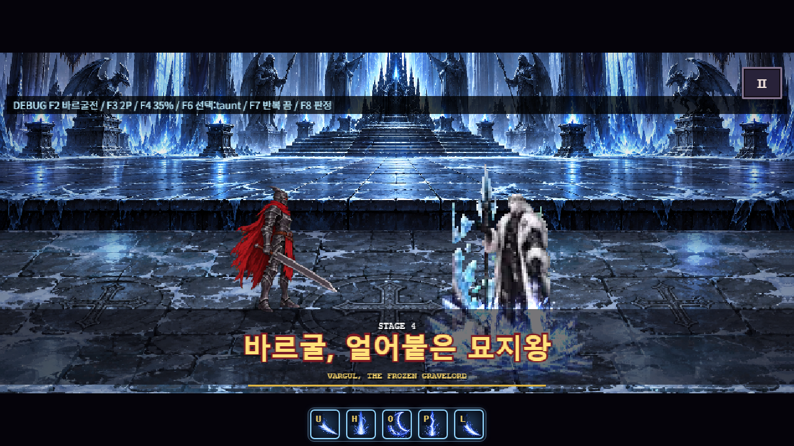

### 빙검 표식

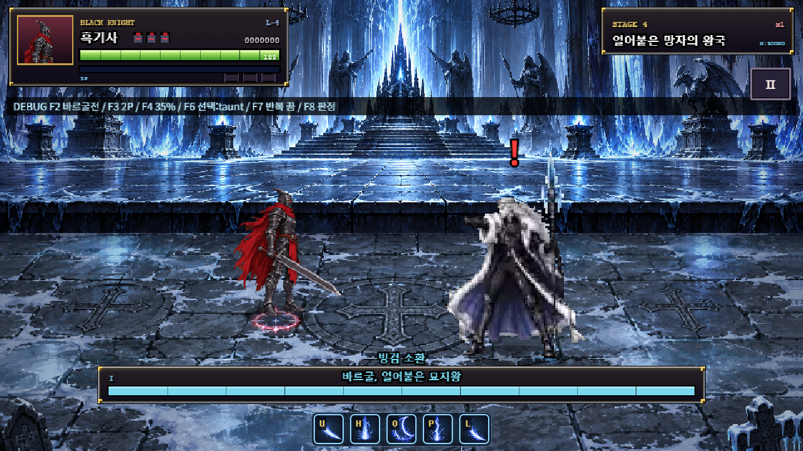

### 십자 표식

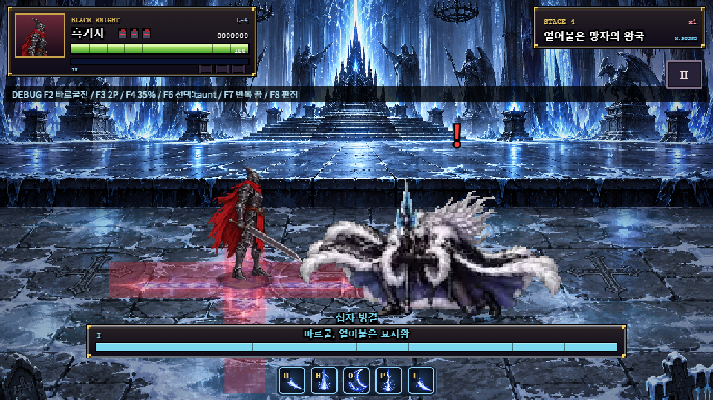

### 십자 분출

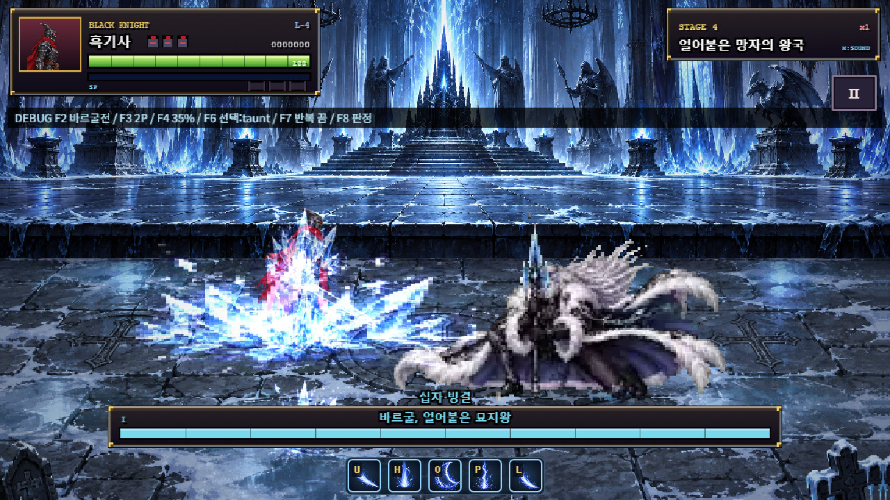

### 구슬 궤도·몸 상자

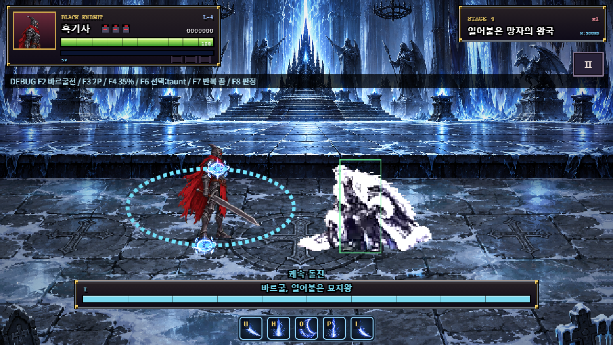

### 궁극기 고정 표식

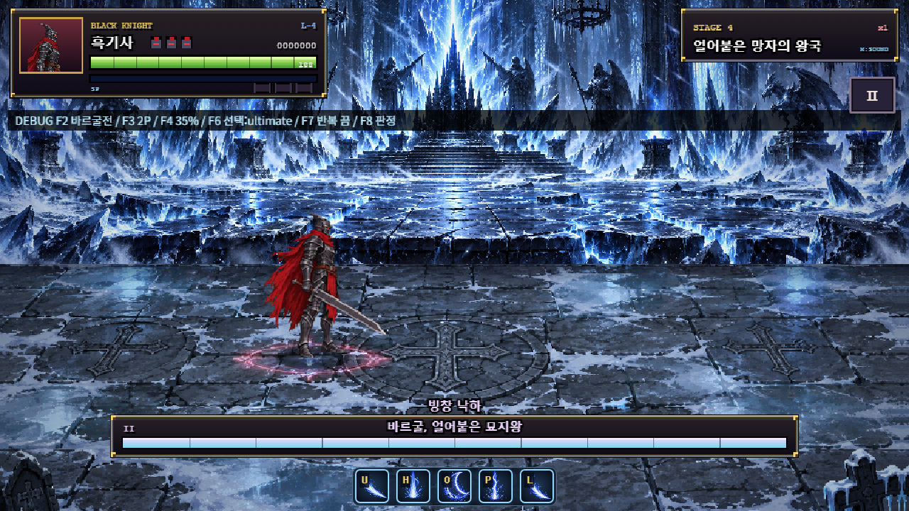

### 거대 창 낙하

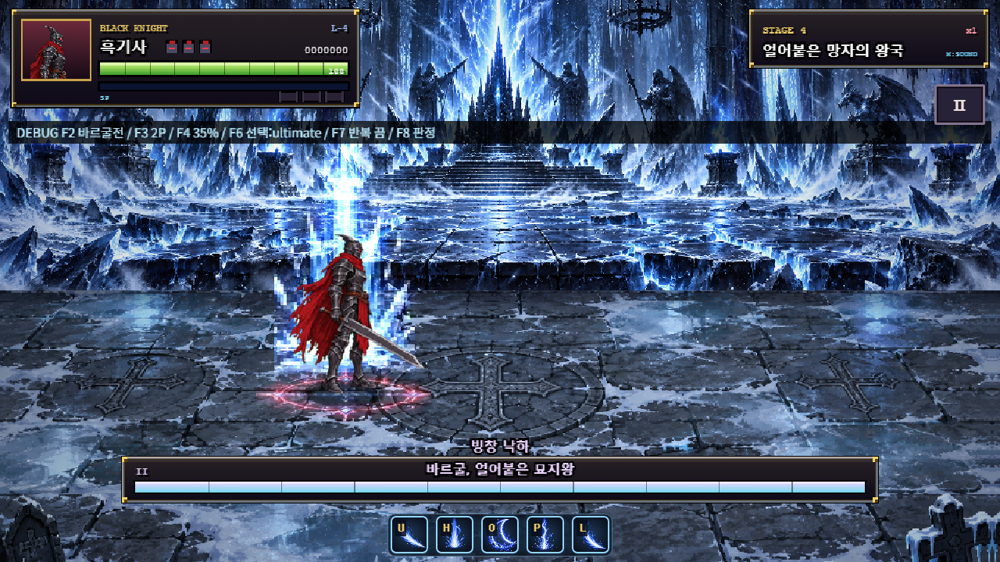

### 궁극기 충돌

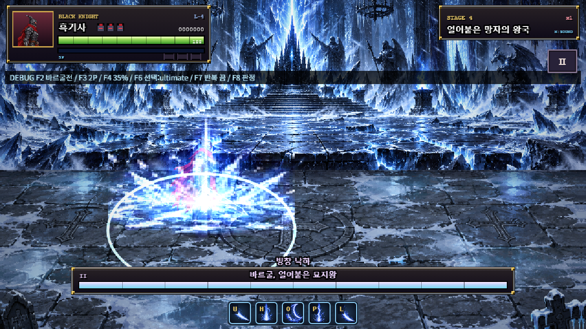

### 착지 후 무릎

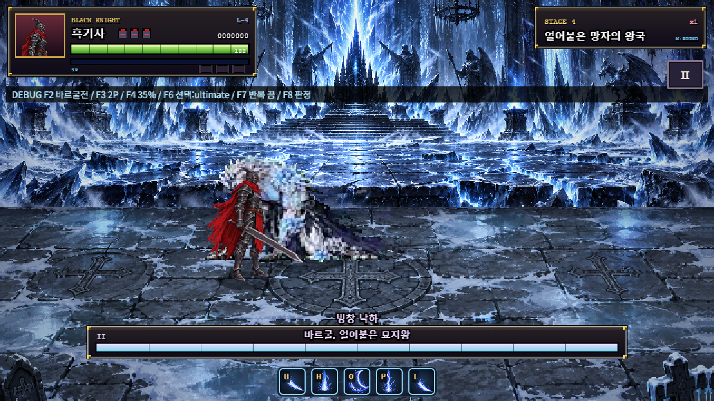

### awaken 실제4장(d8) 몸통 폭발

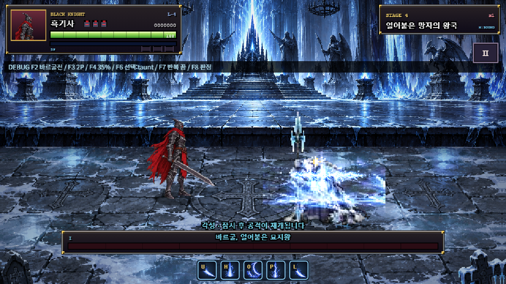

### 2페이즈 문신 밝음


### 같은 그림의 문신 어두움

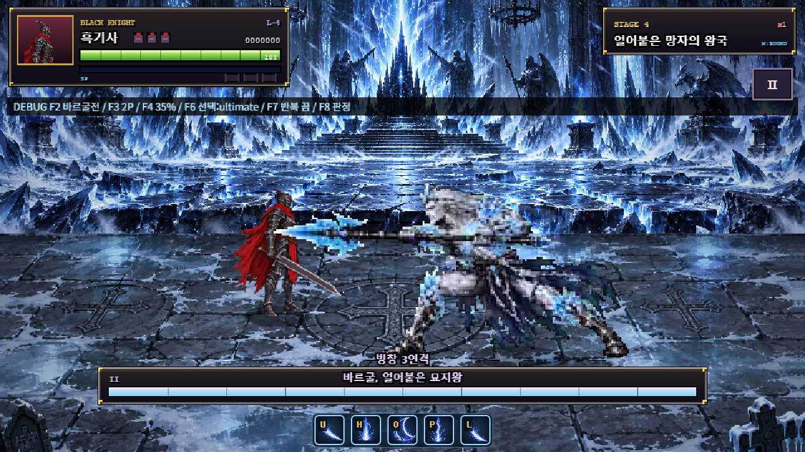

### 사망16장 잔해 유지

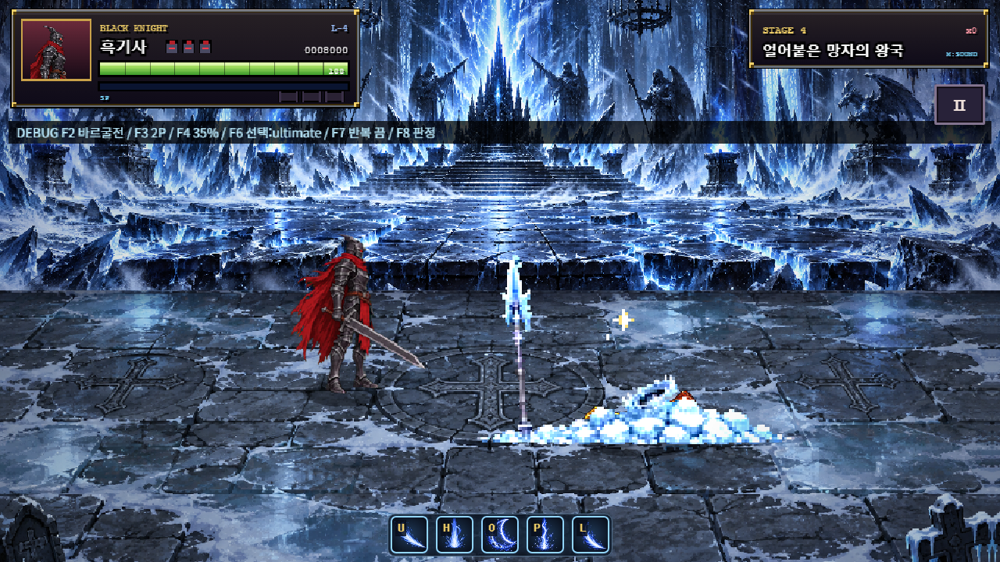


보고서 자체 `docs/boss4_vargul_stage2_report.md`는 이번 단계에 새로 작성한 +227줄이다.
