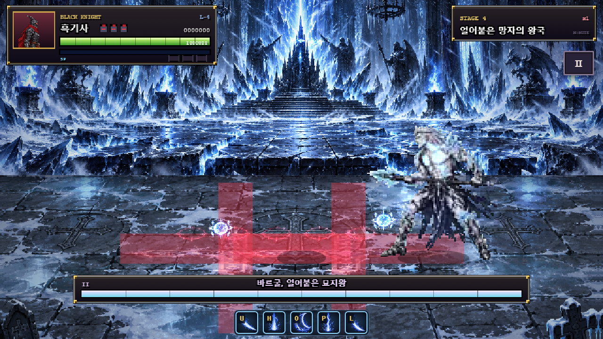

# v1.36 바르굴 — 3단계 수정·실행 검증 보고서

작성일: 2026-10-20 (Asia/Seoul). **A의 수정과 B1–B4 측정을 완료하고 멈춘다. 추가 밸런스 수정은 하지 않았다.**

기준은 [최신 결정 사항](boss4_vargul.md)이다. 모든 수치는 저장소의 실제 JavaScript를 Chrome에 로드해 실행했다. 계산식만으로 성공·실패를 결정하지 않았다. [전체 실행 원본](../artifacts/vargul-1.36/stage3/results.json), [시험 코드](../tests/vargul-stage3.cjs), [보고서 생성기](../tools/report_vargul_stage3.py).

## A. 적용한 변경

1. p2_combo 실제12장은 S3틱(τ47–49), 13장은 A4틱(τ50–53), 14장은 A3틱(τ54–56). 기존3타 준비12틱을11장9틱+12장3틱으로 나눠 **총79 / 3타 A7 / R22**를 유지했다. 자동 그림 범위 검사도13–14장으로 바꿨다.
2. 궁극기 중심 base23→공통×1.3 반올림 **30**, 외곽 base10→**13**. 실제 피해 호출로 확인했다.
3. `game.js / damageEnemy`의 체력 문턱 증원에서 `boss4 && !isVargul(e)`일 때만 옛 증원 코드를 허용한다. 새 바르굴은 증원0, 기존 웨이브 궁병1명은 유지한다. 아우렐리온 rogue2 / 최종 보스 brute+archer 증원도 실제 문턱 타격으로 확인했다.
4. 창 사거리는2단계 실측값을 최종 확정했다. 결정4번의 배율 문구를 “그림 기준”으로 정정했다. 그림·피벗·상자 측정값은 재가공하지 않았다.

변경한 제품 파일은 `vargul-data.js`, `game.js`, 기준 문서, README, 패치 노트다. 검증에는 새 `tests/vargul-stage3.cjs`, 이 생성기와 기존 브라우저 실행기의3단계 진입점을 추가했다. 기존 검증의 궁극기 기대값을30→23으로 정정하고 산출 경로 선택을 지원해2단계 기록을 보존했다. **`vargul-art.js`와 프레임 메타데이터의 해시는 변하지 않았다.**

### 앞/뒤 이름과 창끝 방향 검사

활성 틱 전체를 검사하되 몸통 돌진은 창 공격이 아니므로 제외했다. combo 판정은 전방으로 분류했다. 원본 그림의 +x/−x 기준이며 화면 좌우 뒤집기와 구별한다. 비예외 불일치 **0건**. 요청대로 아래 sweep만 목록에 남기고 고치지 않았다.

| P | 판정 | 실제 그림 | 창끝 x |
| --- | --- | --- | --- |
| 1 | sweep_front | 5 | -113.245 |
| 2 | sweep_back | 3 | 79.038 |


## 공통 시험 조건과 시간 기준

- 격리 Chrome, 실제 `update()`·`updPlayer()`·상태 머신·피격 함수. 이동은 실제 held 방향 입력, 점프·J는 실제 버퍼 입력 처리다. 더블탭·대시·스킬·파워업은 사용하지 않는다.
- 자동 바렐은 생존용 최대HP만1,000,000으로 두고 **피격 무적은0에서 시작**한다. 피해, 경직, 넉백, 다운, 피격 후 무적, 히트스톱은 공통 코드를 그대로 실행한다. HP 확장은 공격력이나 이동 성능에 영향을 주지 않는다.
- B1/B2는 강제 단일 기술의 통제 실험이다. 기술이 끝난 뒤 새 AI 기술과 추격은 막아 잔류 표식·첫 타 도달만 관찰한다. 이는 R을 연장하는 처리가 아니다. R이 끝난 뒤의 적중은 무조건 “불가”다.
- τ=0은 기술의 첫 실행 틱. 위치는 월드 `(x,깊이 y,높이 z)`이며 설계의 z는 엔진 y다. 일반 첫 타는 `reach80 + 현재 보스 hw`를 실제 접근 판정 사거리로 쓴다. 공격 중 전진도 실제 코드로 실행된다.
- B1 실측은 회피 위치를 기록한 시점부터 피해가 들어간 `update()` 횟수다. 입력을 소비해 공격 상태를 만드는 첫1회도 포함하므로 계산식의 시동8보다1틱 많을 수 있다. 반격 계산은 요청한 `ceil(max(max(0,거리−사거리)/3.1, |줄차|/2.325))+8`을 그대로 병기한다.
- B4는 **매 페이즈36,000회=600초**, 총72,000회를 생략 없이 실행한 가속 게임 시뮬레이션이다.20분의 실제 대기 시간을 잰 시험은 아니다. 렌더링을 생략했으며 AI·입력·판정·타이머·히트스톱은 실행했다. 프레임 성능은 별도60초 실제 RAF로 잰다.

## B1. 반격 실행 표

combo/sweep은 깊이 약42만큼 이동한다. 돌진은 첫 예고12틱 뒤 줄 변경, P2 귀환에는 회전·시동 중 보스에서 멀어지는 x 이동도 더했다. 십자는 표식마다 **보스 쪽 대각선**으로 x약28·깊이약21 이동하고 탈출 후 멈춘다. 빙검은 계속 걸어 모든 검이 끝날 때까지 기다린다. 구슬은 생성 R부터 접근하는 경우와 시동부터 접근하는 경우를 분리했다. 궁극기는 고정 후 x65 이동·충돌8틱 전 점프, 실제 착지 후부터 반격한다.

모든 본표의 회피 중 피해는0이다. 결과는 지정한 시작 거리·입력 동선의 측정이며 모든 위치의 최적 반격을 뜻하지 않는다.

| P | 기술 | 회피 후 거리 / 줄차 | 접근 사거리 | R 전체 / 남은R | 계산 틱 | 실측 첫 타 틱 | 판정 | 회피 중 피해 |
| --- | --- | --- | --- | --- | --- | --- | --- | --- |
| 1 | 빙창3연격 | 70.00 / 41.85 | 98.531 | 26 / 26 | 26 | 17 | 가능 | 0 |
| 1 | 쾌속돌진 | 45.82 / 46.50 | 98.531 | 36 / 36 | 28 | 19 | 가능 | 0 |
| 1 | 빙검소환 | 220.00 / 0.00 | 98.531 | 30 / 0 | 48 | 49 | 불가 | 0 |
| 1 | 십자빙결 | 122.10 / 20.92 | 98.531 | 24 / 24 | 17 | 17 | 가능 | 0 |
| 1 | 얼음구슬 | 180.00 / 0.00 | 98.531 | 30 / 30 | 35 | 36 | 불가 | 0 |
| 1 | 창휘두르기 | 70.00 / 41.85 | 98.531 | 22 / 22 | 26 | 17 | 가능 | 0 |
| 1 | 냉소 | 270.00 / 0.00 | 99.000 | 70 / 70 | 64 | 65 | 가능 | 0 |
| 2 | 빙창3연격 | 70.00 / 41.85 | 99.934 | 22 / 22 | 26 | 17 | 가능 | 0 |
| 2 | 쾌속돌진 | 170.40 / 65.10 | 99.934 | 30 / 30 | 36 | 32 | 불가 | 0 |
| 2 | 빙검소환 | 220.00 / 0.00 | 99.934 | 30 / 0 | 47 | 48 | 불가 | 0 |
| 2 | 십자빙결 | 94.20 / 41.85 | 99.934 | 24 / 24 | 26 | 17 | 가능 | 0 |
| 2 | 얼음구슬 | 180.00 / 0.00 | 99.934 | 30 / 30 | 34 | 35 | 불가 | 0 |
| 2 | 창휘두르기 | 70.00 / 41.85 | 99.934 | 22 / 22 | 26 | 17 | 가능 | 0 |
| 2 | 빙창낙하 | 10.10 / 18.00 | 99.934 | 90 / 89 | 16 | 18 | 가능 | 0 |


### 시동을 활용한 대안도 실제 실행

| P | 기술 | 판정 | 시동부터 첫 타 | 보스 피해 | 바렐 피해 |
| --- | --- | --- | --- | --- | --- |
| 1 | 빙검소환 | 예고 중 끊기 | 26 | 10 | 0 |
| 1 | 얼음구슬 | 시동 중 접근 | 36 | 10 | 0 |
| 2 | 빙검소환 | 예고 중 끊기 | 26 | 10 | 0 |
| 2 | 얼음구슬 | 시동 중 접근 | 35 | 10 | 0 |


P2 빙검 접근을0~6틱 늦춘 추가 실행이다.2틱까지는 표식0개로 끊었고,3틱부터는 이미 놓은1개가 남았다. “예고 중 끊기”와 “모든 표식 취소”를 같은 뜻으로 쓰지 않는다.

| 접근 지연 | 첫 타 update 횟수 | 이미 놓인 표식수 |
| --- | --- | --- |
| 0 | 26 | 0 |
| 1 | 27 | 0 |
| 2 | 28 | 0 |
| 3 | 29 | 1 |
| 4 | 30 | 1 |
| 5 | 31 | 1 |
| 6 | 32 | 1 |


- **왕복 뒤:** 거리170.40 / 줄차65.10. 순수 줄 회피의 귀환 실패를 피하려고 x도 벌린 뒤에는 첫 타32틱으로 R30에2틱 모자랐다. 계산식은36틱이다.
- **십자2개 뒤:** 거리94.20 / 줄차41.85, 실제 첫 타17틱으로 R24에 들어간다. 계산26과 다른 이유는 공통 근접 깊이 허용24 안에 들어가면 공격할 수 있어 줄차를0까지 지울 필요가 없기 때문이다.1P sweep과2P combo도 같은 이유로 계산보다 빨랐다.
- **빙검 전부 종료 뒤:** P1 마지막 판정은τ113–118, 제거는τ119 뒤이며 반격 시작τ120. P2는τ121–126, 제거τ127 뒤이며 반격 시작τ128. 이때 몸 R은 각각τ69–98 / τ84–113으로 이미 끝났다. 첫 타49/48틱을 실제로 넣어 보았지만 **R 안의 반격은 아니다**. 거리 단축만으로 이 R 공백은 해결되지 않는다.
- **궁극기:** 착지 보스는 실제 **(275,402)**, 바렐은 **(285.10,420,66.15)**다. 착지 이벤트 실행 후 다음 틱에 위치를 기록해 남은 R은89. 점프 착지를 기다리는 시간까지 포함해18틱 뒤 첫 타로 성공했다. 공중 높이를 무시하는 계산식은16틱이다.
- 냉소는 거리270에서65틱, R70 중 여유5틱. 구슬은 생성 후 접근만 하면35/36틱이라 R30을 놓치지만 시동부터 접근하면35/36틱째, 즉 R 안에 들어간다.

## B2. 자동 회피 실행 표

반응 지연의 “한계”는0부터 한 틱씩 늦추어 실제 무피격인 마지막 입력을 찾은 값이다. 십자의 여유는 경고 대기−팔 탈출 시간이다. 상이한 시험의 여유를 같은 통계값으로 섞지 않았다.

| 기술 | 입력 | 1페이즈 | 2페이즈 | 시간 여유/결과(틱) |
| --- | --- | --- | --- | --- |
| 빙창3연격 | 첫 예고부터 줄 이동 | 0피격 | 0피격 | 반응 지연 한계11 / 8 |
| 십자 | 교차점에서 대각선 | 7틱 탈출, 0피격 | 각각7틱, 2개 모두0피격 | 53 / 44 |
| 십자 | x만 계속 걷기 | 40틱 탈출, 0피격 | 40틱 탈출, 0피격 | 20 / 11 — 설계 기대와 다름 |
| 십자 | 깊이만 이동 | 15피해 | 20피해 | 탈출 실패 |
| 빙검 | 계속 걷기 | 3표식0피격 | 5표식0피격 | 첫 표식 후 출발 지연 한계38 / 31 |
| 빙검 | 제자리 | 2피격·총24 | 2피격·총32 | 회피 아님 |
| 돌진 | 흰 예고 후12틱 지연 줄 변경 | 0피격 | 귀환18피해(최대거리 시험) | 1P 지연한계51−12=39 / 귀환 예고10−반응12=−2 |
| 궁극기 | 고정 후 x로 중심 이탈 | 사용 안 함 | 19틱에 이탈 | 30−19=11 |
| 궁극기 | 점프 없이 외곽까지 달리기 | 사용 안 함 | 반응0–4틱만 전체 무피격 | 4 — 6틱 미만 |
| 궁극기 | 중심 이탈 후 외곽 점프 | 사용 안 함 | 충돌 전27–2틱 입력 성공, 26틱 폭 | 권장 전8틱 입력이면 늦은 경계까지6틱 |
| 구슬 | 반짝임 뒤 줄 변경, 첫 탄막 | 1발0피격 | 2발0피격 | 지연 한계34 / 26 |
| 구슬 | 수명 전체 단순 줄 왕복 | 1피격·총8 | 2피격·총20 | 단순 왕복 무피격 보장 실패 |
| 휘두르기 | 점프만 | 시동0–4틱 점프는0피격 | 시험한 시동0–24틱은 모두 피격 | 1P 5틱 폭 — 설계 기대와 다름 |
| 휘두르기 | 깊이 변경 후 반격 | 0피격, 첫 타17틱 | 0피격, 첫 타17틱 | R22−17=5(반격 여유) |
| 냉소 | 접근 | 거리270에서65틱 첫 타 | 사용 안 함 | R70−65=5(반격 여유) |


### 궁극기 점프의 실제8틱 높이

전체 궁극기 시동부터 실행하고 고정 후80만큼 이동해 외곽을 통과했다. 점프 시점을 충돌 기준−45~+11틱으로 전수 검사했다. 성공 입력은 **τ114~139(충돌27~2틱 전), 포함26틱 폭**이다. 별도 고정 외곽 점에서도 같은 범위를 확인했다.

충돌8틱 전 점프한 경우 높이는 **61.40, 66.60, 71.25, 75.35, 78.90, 81.90, 84.35, 86.25**. 실제 판정τ141~148의 **8/8틱 모두10.224 초과**, 피해0이었다. “8틱 중 한 순간만 높다”를 성공으로 세지 않았다. 가장 늦은 성공은 충돌2틱 전이라 경계 입력은 빡빡하다.8틱 전을 택하면 늦은 경계까지6틱 여유가 있다.

고정 중심만 나가는 데에는19틱으로11틱 여유가 있지만, **중심 밖도 외곽13피해 구간**이다. 점프 없이 계속 달려 전체 무피격이 되는 것은 시작 지연0~4틱뿐이었다. 중심 회피와 전체 무피격을 구별해야 한다.

### 설계 기대와 다른 항목

- 십자 x만 이동도 성공했다. 가로 팔 끝122.688을40틱에 넘기기 때문이다. 깊이만 움직인 시험은 전무대 세로 팔에 남아15/20피해를 받았다. 대각선은 실제 첫 중심에서7틱, P2 두번째 중심에서도7틱에 벗어났다.
- 귀환 돌진의 예고는10틱이라12틱 반응이 끝나기 전에 이미 출발한다. 거리220/270에서는 반응0틱도 왕복 전체 무피격이 아니었지만 거리100/150에서는12틱 반응도 성공했다. 따라서 모든 거리에서 실패한다고 일반화하지 않는다. 아래는 x450에서 시작한 보스에 대한 실제 초기 거리별 결과다.
- P1 sweep은 시동0~4틱의 이른 점프로 피했다. “점프로 불가”라는 원문 기대와 다르다. P2는 시동0~24틱의 시험에서 모두 피격했다. P2 지상 거리70/79/81은 모두16피해, 거리92는0피해여서 **창끝79.038 + 플레이어 반폭12** 판정과 일치했다.
- 구슬 첫1발/2발은 즉시 또는12틱 늦게 줄을 바꿔도0피격이었다. 그러나600틱 수명 전체를355↔485 줄 왕복만 하는 자동 입력은 P1 1피격(8), P2 2피격(20)이었다. 단순 반복 이동이 모든 탄막을 보장해서 피한다는 뜻은 아니다.

| P | 초기 x거리 | 반응 지연 | 왕복 전체 받은 피해 |
| --- | --- | --- | --- |
| 1 | 100 | 0 | 0 |
| 1 | 100 | 12 | 0 |
| 1 | 150 | 0 | 0 |
| 1 | 150 | 12 | 0 |
| 1 | 220 | 0 | 0 |
| 1 | 220 | 12 | 0 |
| 1 | 270 | 0 | 0 |
| 1 | 270 | 12 | 0 |
| 2 | 100 | 0 | 0 |
| 2 | 100 | 12 | 0 |
| 2 | 150 | 0 | 0 |
| 2 | 150 | 12 | 0 |
| 2 | 220 | 0 | 18 |
| 2 | 220 | 12 | 18 |
| 2 | 270 | 0 | 18 |
| 2 | 270 | 12 | 18 |


## B3. 아우렐리온과 새로 잰 처치 비교

시작 HP는 실제 **1800+2200 / 2000+2500**.1.35 결과는 읽지 않았다. 동일 시드1360303, 동일 입력: 보스에서35~58 거리 유지·줄차6 이내로 걸어서 따라가며 **6틱마다 J**. c1/c2/c3와 마지막 검기를 실제로 사용한다. 스킬·점프·필살기·아이템·파워업은 없다. 드롭은 다음 입력 전에 제거해 전투 보상을 사용하지 않는다.

주 결과는 **실제 보스 AI 켬**이다. 보스 자율 공격만 정지한 참고 실험도 같은 입력으로 별도 실행했다. 참고 실험에서도 Aurelion의 공통 체력 문턱 증원은 남겼으므로 증원 피해가 있다. 생존용HP만 확장했고 피격 상태·무적·히트스톱을 생략하지 않았다. 시작은 등장 종료 상태, 끝은 최종 HP0이며 사망 그림 대기 시간은 제외했다.

타수는 보스에 피해를 준 호출 수(일반 검기 포함), 휘두름은 실제 `startAtk` 횟수다. 다른 적을 친 타수는 보스 타수에 넣지 않는다. 전환 칸은 `phaseT>0`인 업데이트 슬롯이며 이 동안 발생한 히트스톱도 포함한다. 순수 전환 진행 길이는 Aurelion242 / Vargul288이다.

| 조건 | 보스 | HP | 피해 타수 | 휘두름 | 처치 초 | 전환 슬롯 / 초 | 히트스톱 슬롯 | 다운 슬롯 | 기절 슬롯 | 증원수 | 바렐 피해 |
| --- | --- | --- | --- | --- | --- | --- | --- | --- | --- | --- | --- |
| 실제 AI | 아우렐리온 | 1800+2200 | 212 | 254 | 135.783 | 254 / 4.233 | 1240 | 379 | 3278 | 12 | 367 |
| 실제 AI | 바르굴 | 2000+2500 | 240 | 256 | 133.250 | 291 / 4.850 | 1136 | 390 | 3207 | 0 | 376 |
| 보스 자율 공격만 정지 | 아우렐리온 | 1800+2200 | 202 | 226 | 110.533 | 262 / 4.367 | 1084 | 400 | 3038 | 12 | 153 |
| 보스 자율 공격만 정지 | 바르굴 | 2000+2500 | 207 | 231 | 113.583 | 294 / 4.900 | 929 | 386 | 3214 | 0 | 0 |


실제 AI 조건에서 바르굴은 아우렐리온보다 시간은 **2.533초(약1.9%) 짧았고**, 피해 타수는 28회 더 필요했다. 표와 반대였던 이전 비교 문장을 4단계에서 원본 JSON 기준으로 정정했다. 단일 시드·고정 입력 비교이며 숙련자의 실제 처치 시간이나 난이도 순위를 확정하는 수치는 아니다. 체력 문턱·그로기·기절·변신·히트스톱·해당 보스의 증원을 모두 포함했다.

## B4. 페이즈마다600초 행동 분포

가속 실행이지만 각 페이즈36,000번 모두 실제 `update()`를 호출했다. 목표 거리는65→150→285를20초마다 바꾸고 held 이동으로 접근한다. 실제 선택 직전의 x 차이로 근(<81.792)/중(<204.48)/원을 분류한다. 깊이는 보스 부근 ±10을 오간다. 공격 입력은 없고 무적도 없으므로 피격·다운에 따른 AI 지연은 남는다. P2는300초에 HP875를 만들어 궁극기를 검사한다. 시드는 P1 136031 / P2 136032.

| P | 게임 초 | 실제 update 슬롯 | 공격 시작수 | 규칙 위반수 | 최대 행동 간격 | 최대 동일 상태 정체 | 첫 궁극기 |
| --- | --- | --- | --- | --- | --- | --- | --- |
| 1 | 600 | 36000 | 252 | 0 | 198 | 6 | 없음 |
| 2 | 600 | 36000 | 224 | 0 | 307 | 6 | τ18071, HP875 |


3연속 기술·다른 castToken의 바닥 기술 겹침 **각0건**. 같은 P2 십자의 두 표식이나 한 시전의 빙검 여러 개는 겹침 위반으로 세지 않았다. 최대 행동 간격은198/307틱, 상태 진행 정체는각6틱(히트스톱 범위)으로 장기 정지나 무한 대기를 관찰하지 못했다. 첫 궁극기는 HP875 설정 후71틱 뒤, 다음 행동으로 실행됐다.

### 실제로 시작한 기술 횟수·구간 내 비율

| P | 구간 | 공격 시작 합계 | 기술별 횟수(비율) |
| --- | --- | --- | --- |
| 1 | near | 92 | 십자빙결 16(17.4%), 창휘두르기 25(27.2%), 빙창3연격 51(55.4%) |
| 1 | mid | 102 | 쾌속돌진 31(30.4%), 빙검소환 32(31.4%), 십자빙결 30(29.4%), 얼음구슬 9(8.8%) |
| 1 | far | 58 | 빙검소환 15(25.9%), 쾌속돌진 29(50.0%), 냉소 10(17.2%), 얼음구슬 4(6.9%) |
| 2 | near | 78 | 십자빙결 10(12.8%), 빙창3연격 34(43.6%), 쾌속돌진 15(19.2%), 창휘두르기 14(17.9%), 빙창낙하 5(6.4%) |
| 2 | mid | 104 | 쾌속돌진 26(25.0%), 얼음구슬 8(7.7%), 빙검소환 34(32.7%), 십자빙결 29(27.9%), 빙창낙하 7(6.7%) |
| 2 | far | 42 | 얼음구슬 6(14.3%), 쾌속돌진 20(47.6%), 빙검소환 14(33.3%), 빙창낙하 2(4.8%) |


### 설계 가중치와 추첨 분포 비교

아래 “추첨”에는 이동 선택도 포함한다. 실제 시작 칸은 별도로 세었으므로 뒤쪽 대응 sweep과 첫 궁극기 우선 실행도 확인할 수 있다. 설계 가중치는 원래 표의 값(합100)이다. 쿨타임·동일 기술2회·남은 표식·남은 구슬 때문에 후보가 제거되므로 실행 비율이 원래 가중치와 같아야 하는 것은 아니다. “가용 기대”는 매 추첨 시 실제 가용 후보의 정규화 확률을 누적했다. 각 구간에서 그 합이 실제 추첨 수와 일치하는지도 검사했다. 궁극기의 후속 사용 가중치15는 기존2단계 구현 그대로다.

| P | 구간 | 기술 | 설계 가중치 | 실제 추첨수 / 비율 | 가용 기대수 / 비율 | 실제 시작수 |
| --- | --- | --- | --- | --- | --- | --- |
| 1 | 근 | 빙창3연격 | 40 | 51 / 41.5% | 50.27 / 40.9% | 51 |
| 1 | 근 | 창휘두르기 | 25 | 24 / 19.5% | 26.75 / 21.8% | 25 |
| 1 | 근 | 십자빙결 | 15 | 16 / 13.0% | 17.50 / 14.2% | 16 |
| 1 | 근 | 뒤로 빠지기 | 20 | 32 / 26.0% | 28.47 / 23.1% | 0 |
| 1 | 중 | 쾌속돌진 | 25 | 31 / 24.8% | 28.57 / 22.9% | 31 |
| 1 | 중 | 빙검소환 | 25 | 32 / 25.6% | 27.61 / 22.1% | 32 |
| 1 | 중 | 십자빙결 | 20 | 30 / 24.0% | 27.91 / 22.3% | 30 |
| 1 | 중 | 얼음구슬 | 15 | 9 / 7.2% | 12.32 / 9.9% | 9 |
| 1 | 중 | 다가가기 | 15 | 23 / 18.4% | 28.59 / 22.9% | 0 |
| 1 | 원 | 쾌속돌진 | 35 | 29 / 50.0% | 31.77 / 54.8% | 29 |
| 1 | 원 | 빙검소환 | 30 | 15 / 25.9% | 13.85 / 23.9% | 15 |
| 1 | 원 | 얼음구슬 | 20 | 4 / 6.9% | 5.47 / 9.4% | 4 |
| 1 | 원 | 냉소 | 15 | 10 / 17.2% | 6.91 / 11.9% | 10 |
| 2 | 근 | 빙창3연격 | 35 | 34 / 44.2% | 30.45 / 39.5% | 34 |
| 2 | 근 | 창휘두르기 | 25 | 14 / 18.2% | 18.05 / 23.4% | 14 |
| 2 | 근 | 십자빙결 | 20 | 10 / 13.0% | 13.92 / 18.1% | 10 |
| 2 | 근 | 쾌속돌진 | 20 | 15 / 19.5% | 12.62 / 16.4% | 15 |
| 2 | 근 | 빙창낙하 | 별도 | 4 / 5.2% | 1.95 / 2.5% | 5 |
| 2 | 중 | 쾌속돌진 | 25 | 26 / 21.5% | 29.49 / 24.4% | 26 |
| 2 | 중 | 빙검소환 | 25 | 34 / 28.1% | 29.49 / 24.4% | 34 |
| 2 | 중 | 십자빙결 | 25 | 29 / 24.0% | 31.24 / 25.8% | 29 |
| 2 | 중 | 얼음구슬 | 15 | 8 / 6.6% | 10.71 / 8.9% | 8 |
| 2 | 중 | 다가가기 | 10 | 17 / 14.0% | 16.27 / 13.4% | 0 |
| 2 | 중 | 빙창낙하 | 별도 | 7 / 5.8% | 3.81 / 3.1% | 7 |
| 2 | 원 | 쾌속돌진 | 35 | 20 / 47.6% | 19.09 / 45.5% | 20 |
| 2 | 원 | 빙검소환 | 35 | 14 / 33.3% | 15.23 / 36.3% | 14 |
| 2 | 원 | 얼음구슬 | 30 | 6 / 14.3% | 6.24 / 14.9% | 6 |
| 2 | 원 | 빙창낙하 | 별도 | 2 / 4.8% | 1.44 / 3.4% | 2 |


예를 들어 원거리 구슬은 쌍 수명600 + 소멸 후 쿨타임720으로 원래20/30%보다 적게 나온다. 이를 단순 가중치 버그로 판정하지 않는다. 기대수5 이상 칸에서 가장 큰 |실제−기대|/√기대는 **1.18**(1P far 냉소)였다. 이번600초 표본에서 가용 확률과 크게 어긋나는 한쪽 집중은 관찰하지 못했다. 여러 시드의 통계적 보증을 한 시험은 아니다.

## 고칠 방법 후보 — 적용하지 않음

| 항목 | 실제 원인 | 후보 |
| --- | --- | --- |
| P2 왕복 뒤 반격 불가 | 안전 회피 뒤 거리170.4·줄차65.1, 실측32>R30 | 이 시험만 맞추면 R+2, 요청 계산까지 맞추면 R36(+6). 귀환 종료 위치·줄 이동량 완화도 후보 |
| P2 귀환12틱 반응 실패 | 예고10<반응12, 늦은 줄 추적과 종점 근접으로 시작부터 몸통이 닿음 | 귀환 예고를 약20틱으로 늘리는 것과 **줄 고정을 출발 최소7~8틱 전으로 앞당기는 것**을 함께 검토. 시동만 늘리고 마지막까지 추적하면 해결되지 않음 |
| 빙검 전부 종료 후 반격 불가 | 마지막 검 제거보다 R 종료가21/14틱 먼저임 | 모든 검 판정이 끝난 뒤 R을 시작하는 안. 계속 걸어 거리220까지 벌린 이 시험에는 그 뒤에도48~49틱 필요. 최소 이동·시전 끊기 중심 설계 유지도 후보 |
| 구슬 R만 접근하면 불가 | 거리180에서35/36틱, R30 | R36 이상 또는 가까운 거리에서만 사용. 현재를 유지하며 시동 접근 기회로 명시하는 안 |
| 십자 x만 이동 성공 | 변환된 가로 팔122.688이 걷기40틱 거리보다 짧음 | 가로 팔을 경고 동안의 이동보다 길게(중앙 시험 기준 약190 이상) 하거나 화면 전체로 확장. 또는 x만 탈출도 허용하도록 설계 정정 |
| P1 sweep 점프 회피·5틱 입력 폭 | 활성 창 경로보다 점프 정점이 높고 뒤쪽으로 창이 넘어감 | 기존 그림에 맞춰 P1 점프 회피를 허용하거나, 그림·활성 높이·범위의 일치를 다시 설계. 이번에는 상자를 늘리지 않음 |
| 궁극기 지상 전체 탈출 여유4틱 | 중심은 나가도 큰 외곽 안에 남음 | 외곽 점프를 공략으로 명확히 안내. 지상 탈출도 원한다면 충돌을2틱 이상 늦추거나 외곽 반경을 재검토 |
| 궁극기 점프 늦은 경계 | 충돌2틱 전이 마지막 성공, 그 뒤는 높이 부족 | 권장 타이밍을 충돌8틱 전 부근으로 안내해 늦은 쪽6틱 확보. 입력 버퍼·낮은 고리 높이 재검토도 후보 |
| 냉소·sweep·2P combo 반격 여유5틱 | 냉소65/70, sweep·2P combo17/22 | 접근 거리 제한 또는 R을 소폭 늘리는 안. 현재 정해진 거리에서는 이미 반격 가능 |
| P2 빙검 완전 취소 여유2틱 | 거리150에서 접근 지연2틱까지 표식0,3틱부터1개 남음 | 시동 접근을 미리 시작하도록 안내하거나 시동을 늘림. 늦으면 이미 놓인 표식이 남는 현재 집중 중단 규칙을 함께 읽혀야 함 |
| 구슬 수명 전체 단순 왕복 실패 | 매번 같은 두 줄을 오가다 멈추는 동안 이전/새 파편에 피격 | 플레이어가 실제 파편을 계속 읽게 하는 현재 의도를 유지하거나, 사격/수명/탄 속도 조정 여부를 후속 결정 |

## 콘솔·회귀·60fps

콘솔 오류·예외 **0건**. 기존 전용14개 페이즈별 기술 회귀와 전체72개 보스 기술/페이즈·1~5스테이지 클리어 회귀를 통과했다. [전체 로그](../artifacts/vargul-1.36/stage3/full-regression.log), [전용 회귀](../artifacts/vargul-1.36/stage3/regression/results.json).

성능 장면은 **정상 AI에서는 바닥 기술 중복 금지로 만들지 않는 강제 부하 장면**이다. P2 몸·문신·오라와 십자2개, 빙검5개, 구슬2개 및 파편을 함께 그린다. 최종 시험은 업데이트 후에도 소멸한 것을 채워 렌더 직전 최소2/5/2를 유지한다. 이 시험만 플레이어 무적을 켜 피격 히트스톱으로 부하가 줄지 않게 했다. 이는 B4의 중복 금지 검사와 별개의 fixture다. Windows 헤드리스Chrome, 창1280×720·게임960×540, GPU 비활성, 실제 RAF60초.

| 시험 | 초 | 프레임 | 평균fps | 평균CPU ms | p95 CPU ms | 최대CPU ms | 최대 hazard |
| --- | --- | --- | --- | --- | --- | --- | --- |
| 첫 시험(업데이트 전 보충) | 60.016 | 3598 | 59.95 | 1.166 | 2.700 | 90.200 | 15 |
| 최종 시험(렌더 직전까지 보충) | 60.011 | 3602 | 60.02 | 1.138 | 2.700 | 4.200 | 15 |


최종 프레임 간격 평균 **16.661ms**, p95 **16.700ms**. 평균은60fps 부근이지만 첫 시험에서최대90.2ms 스파이크가 있어 **항상60fps 유지라고 단정하지 않는다**. 원인은 프로파일링하지 않았으며 GC 등으로 확정하지 않았다. 후속 후보는 스파이크 추적과 이펙트/할당 프로파일링이다. 이 단계에서는 성능 관련 제품 코드를 바꾸지 않았다.



## README와 남은 상태

README 공략을 실제 측정대로 고쳤다. 십자 x만 탈출, P1 sweep 점프 회피, P2 귀환12틱 반응 실패, 빙검 종료 후 R 부재, 구슬 시동 접근, 궁극기 중심 탈출 뒤 외곽 점프를 구분한다. 위 후보는 제품 코드에 적용하지 않았다. **3단계 보고 후 중지한다.**

재현(PowerShell):

```powershell
$env:VARGUL_STAGE3='1'
$env:VARGUL_STAGE3_BENCH='1'
node tests/regression.cjs
```

생성: `python tools/report_vargul_stage3.py`. 게임 아트 추가량0bytes. 상세 입력, 각 지연·점프 시점의 피해와 높이,600초의 모든 행동 시작 기록은 원본JSON에 있다.
