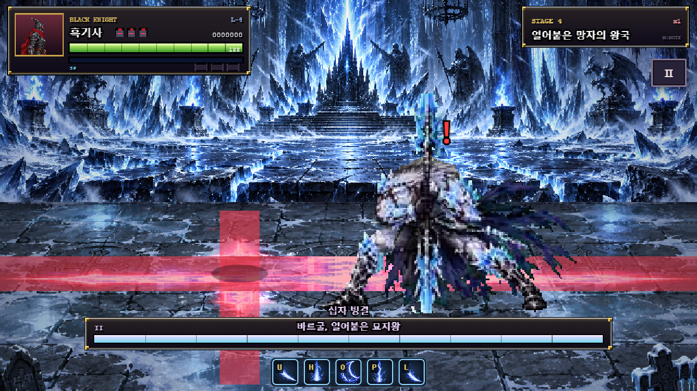

# v1.36 바르굴 — 4단계 수정·재검증 보고서

작성일: 2026-10-20 (Asia/Seoul). **지정한 네 변경을 적용하고 해당 부분 재측정·전체 회귀를 마친 뒤 멈춘다.**

기준: [최신 결정 사항](boss4_vargul.md). [실행 원본](../artifacts/vargul-1.36/stage4/results.json), [4단계 실행기](../tests/vargul-stage4.cjs), [공유 시험 코드](../tests/vargul-stage3.cjs). 실제 Chrome에서 제품 JavaScript의 `update()`·입력·AI·판정을 실행했다. 시간 단위는 60Hz 틱이며 시뮬레이션은 가속 실행했다. 이번 단계에는 행동 분포·궁극기·성능을 다시 측정하지 않았다.

## 바뀐 값

| 항목 | 전 | 후 |
| --- | --- | --- |
| P2 귀환 흰 예고 | 10 | 18 (추가 ×0.85 없음) |
| P2 귀환 줄 고정 | 예고 8틱째, 출발 2틱 전 | 예고 8틱째 한 번, 출발 10틱 전 |
| P2 마지막 돌진 R | 30 | 34 |
| P2 돌진 총 틱 | 162 | 174 (+12), 첫 돌진 구간 동일 |
| P1 빙검 | R30: τ69–98, 총99 | 마지막 집중 그림11을 τ69–118 유지, R24: τ119–142, 총143 |
| P2 빙검 | R30: τ84–113, 총114 | 마지막 집중 그림12를 τ84–126 유지, R24: τ127–150, 총151 |
| 십자 가로 범위 | 중심 x±122.688 | 현재 카메라의 `[camX, camX+VW]`, VW640 월드 px 전체 |
| 십자 세로 범위 | 무대 깊이 전체, x±18.4032 | 동일 |
| 구슬 R (P1/P2) | 30/30, 총62/57 | 36/36, 총68/63 |

귀환 줄 고정 뒤에는 플레이어를 추적하지 않고, 고정된 줄에 도달하도록 보스만 이동한다. 예고 8틱 이후 바렐의 줄을 강제로 바꿔도 고정값420이 유지되는 것을 실제 실행으로 검사했다. 귀환 고정 이벤트는 한 번이다.

빙검의 마지막 판정은 P1 τ113–118 / P2 τ121–126이며, 바로 다음 틱부터 R이 시작한다. 집중 유지 중 아머 없음·S·마지막 그림을 매 틱 확인했다. 일반 피해로 `hurt`가 되고, 이미 놓인 3/5개는 그대로 남아 판정·소멸까지 실행됐다. 새로운 표식은 생기지 않았다.

십자 경고는 기존 아틀라스를 읽고 가로 띠만 가로로 늘려 그린다. 세로 부분은 기존 폭으로 별도 그린다. 분출·판정 보기 범위도 화면 폭에 맞췄다. 카메라0/1000 및 양 끝 x20/620에서 범위를 검사했다. **`vargul-art.js`와 프레임 메타데이터 SHA-256 동일, 아트 증가0 bytes.**

## B1. 반격 재실행

3단계와 같은 시작 거리·줄 이동·빙검 계속 걷기·구슬 생성 R부터 접근 조건이다. 돌진은 기존 B1의 회전/귀환 예고 중 x거리 벌리기를 그대로 유지했다. 생존 HP만 확장했고 피해·경직·다운·무적·히트스톱은 그대로다. R 종료 이후 새 기술/추격만 막아 첫 타까지 관찰하며, R을 늘리지는 않는다.

계산은 `ceil(max(max(0,거리−실제 사거리)/3.1, |줄차|/2.325))+8`. 좌표는 월드 x/깊이이며 사거리는 바렐 일반 첫 타80+보스 반폭이다. 실측은 실제 공격 피해가 들어간 update 횟수다.

| P | 기술 | 3단계 실측/남은R | 회피 후 거리/줄차 | 접근 사거리 | R전체/남은R | 계산 | 실측 | 판정 | 회피 피해 |
| --- | --- | --- | --- | --- | --- | --- | --- | --- | --- |
| 2 | 쾌속 돌진 | 32/30 불가 | 145.60/65.10 | 99.934 | 34/34 | 36 | 27 | 가능 | 0 |
| 1 | 빙검 소환 | 49/0 불가 | 220.00/0.00 | 98.531 | 24/23 | 48 | 49 | 불가 | 0 |
| 1 | 얼음 구슬 | 36/30 불가 | 180.00/0.00 | 98.531 | 36/36 | 35 | 36 | 가능 | 0 |
| 2 | 빙검 소환 | 48/0 불가 | 220.00/0.00 | 99.934 | 24/23 | 47 | 48 | 불가 | 0 |
| 2 | 얼음 구슬 | 35/30 불가 | 180.00/0.00 | 99.934 | 36/36 | 34 | 35 | 가능 | 0 |

P2 돌진은 실측27틱으로 R34에 들어갔다. 예고가8틱 길어지면서 같은 x입력을8틱 더 실행하므로 회피 후 거리는170.40→145.60으로 바뀌었다. 계산36보다 빠른 이유는 공통 근접 깊이 허용24 안에서 공격할 수 있어 줄차를0까지 줄일 필요가 없기 때문이다.

**빙검은 여전히 불가다.** 모든 검이 소멸한 뒤의 반격 시작은 P1 τ120 / P2 τ128이며 그때 남은 R은23이다(판정 종료 직후 R24 중 첫 틱에 잔류 개체 소멸 처리). 계속 오른쪽으로 걷는 기존 입력은 x620까지 가므로 보스와220 떨어진다. 첫 타49/48틱은 남은23을 넘는다. R이 판정보다 먼저 끝나는 문제는 해결했지만, 멀어진 위치에서 접근할 시간은 부족하다. 후속 후보는 회피 동선·거리 제한 또는 R 연장이며 **추가 적용하지 않았다**.

구슬은 P1 첫 타36틱으로 마지막 R 슬롯에 들어가고, P2는35틱으로1틱 여유다. 성공이지만 넉넉한 반격 시간으로 설명하지 않는다.

## B2. 귀환 돌진과 십자

돌진은 보스x450, 바렐 초기 줄420에서 각 흰 예고 뒤 같은 반응 지연으로 줄을 바꾸는 기존 제어다. x이동·점프는 없다. 왕복 전체 피해를 센다. 지연0–60을 한 틱씩 전수 실행했으며 성공 구간은 아래와 같이 연속이다. “여유”는 마지막 무피격 지연−요구12틱이다.

| 초기 거리 | 귀환 예고 | 12틱 반응 피해 | 무피격 지연 범위 | 추가 반응 여유 |
| --- | --- | --- | --- | --- |
| 100 | 18 | 0 | 0–23 | 11 |
| 150 | 18 | 0 | 0–23 | 11 |
| 220 | 18 | 0 | 0–13 | 1 |
| 270 | 18 | 0 | 0–12 | 0 |

거리100/150/220/270 모두12틱 반응으로 무피격이다. 다만 거리220/270은 여유1/0틱으로 좁다. 요청값은 그대로 유지했다. 더 넓은 여유가 필요하다면 예고·고정 시점·귀환 종점의 후속 조정을 검토할 수 있다.

십자는 실제 시전으로 첫 표식과 P2의30틱 뒤 두 번째 표식을 생성했다. 각 표식은 그 순간 바렐의 교차점 한가운데에서 시작한다. 대각선은 팔을 벗어나면 멈추고 새 표식에서 다시 움직인다. 단일 축은 계속 걷는다.

| P | 입력 | 표식 수 | 실제 총 피해 | 표식별 탈출 틱 | 표식별 여유 |
| --- | --- | --- | --- | --- | --- |
| 1 | x만 | 1 | 15 | 탈출 실패 | — |
| 1 | 깊이만 | 1 | 15 | 탈출 실패 | — |
| 1 | 대각선 | 1 | 0 | 7 | 53 |
| 2 | x만 | 2 | 20 | 탈출 실패, 탈출 실패 | —, — |
| 2 | 깊이만 | 2 | 20 | 탈출 실패, 탈출 실패 | —, — |
| 2 | 대각선 | 2 | 0 | 7, 7 | 44, 44 |

x만/깊이만은 피격, 대각선은 무피격으로 요청한 결과와 일치했다. P2 단일 축 입력은 첫 분출에20피해를 받고 공통 다운·피격 무적으로 두 번째 피해가 추가되지 않는다. 두 번째 판정을 생략한 것은 아니며, 대각선 시험은 두 표식에서 각각7틱 탈출·44틱 여유를 확인했다.



## B3. 바르굴만 다시 잰 처치 비교

시드1360303, 실제 보스 AI 켬, 거리35–58·줄차6 안으로 걸어 따라가며6틱마다 J. 일반 콤보·검기를 사용하고 스킬·점프·아이템·파워업은 없다. HP확장 이외에 피격 무적이나 상태를 바꾸지 않았으며 문턱·그로기·기절·변신·히트스톱을 포함한다. 등장 종료부터 최종HP0까지 센다. 전환 슬롯은 phaseT>0인 update로 전환 중 히트스톱을 포함한다.

아우렐리온은 다시 실행하지 않고 **3단계 JSON 기록**을 그대로 옮겼다. 새 바르굴은 같은 입력으로 두 번 실행해 모든 집계가 동일한지 확인했다.

| 보스/기록 | HP | 피해 타수 | 휘두름 | 처치 초 | 전환 슬롯/초 | 히트스톱 | 다운 | 기절 | 증원 | 바렐 피해 |
| --- | --- | --- | --- | --- | --- | --- | --- | --- | --- | --- |
| 아우렐리온 (3단계 보존값) | 1800+2200 | 212 | 254 | 135.783 | 254/4.233 | 1240 | 379 | 3278 | 12 | 367 |
| 바르굴 (3단계 보존값) | 2000+2500 | 240 | 256 | 133.250 | 291/4.850 | 1136 | 390 | 3207 | 0 | 376 |
| 바르굴 (4단계 재측정) | 2000+2500 | 239 | 248 | 128.167 | 291/4.850 | 1123 | 390 | 3168 | 0 | 286 |

수정 후 바르굴은 이전보다 **5.083초 짧았고**, 보존된 아우렐리온보다 **7.617초(약5.6%) 짧았다**. 타수는 아우렐리온보다27회 많았다. 단일 시드·고정 입력의 결과이며 난이도 순위를 확정하지 않는다.

[3단계 보고서](boss4_vargul_stage3_report.md)의 잘못된 문장도 표 기준으로 고쳤다. 당시 값은133.250 대135.783이므로 바르굴이 **2.533초(약1.9%) 짧고 타수28회가 많다**. 생성기도 JSON에서 차이·방향을 계산하도록 바꿔 이전 숫자가 다시 들어가지 않게 했다.

## 회귀·콘솔과 범위

- 전용14개 페이즈별 기술, 디버그 실제 반복 키, 등장·전환·사망·스테이지 클리어 회귀 통과. [전용 결과](../artifacts/vargul-1.36/stage4/regression/results.json).
- 전체72개 보스 기술/페이즈 및1–5스테이지 클리어 회귀 통과. [전체 로그](../artifacts/vargul-1.36/stage4/full-regression.log).
- 재측정·전용 회귀·전체 회귀에서 콘솔 error·브라우저 예외0. 전체 회귀도 Console/Log 오류 수집을 켜 실행했다.
- 아트 해시 동일. 성능·행동 분포·궁극기 회피는 이번 범위에서 재측정하지 않았다. 3단계 값은 이전 코드의 기록이다.

변경 제품 파일은 `vargul-data.js`(틱 데이터), `vargul-runtime.js`(화면 폭 십자 판정·그리기)다. 기준 문서·README·패치 노트를 갱신했다. 시험은 기존 `tests/vargul-stage3.cjs` 제어 함수를 공유하고 선택 실행기 `tests/vargul-stage4.cjs` 및 회귀 기대값을 추가했다. 보고 생성기는 `tools/report_vargul_stage4.py`이며 3단계 생성기의 비교 문장도 정정했다.

README에는 십자 대각선 탈출, 귀환 때 두 번째 줄 변경, 빙검 전부 낙하 뒤 R24와 거리 주의, 궁극기 충돌 직전 외곽 점프를 반영했다. **요청한 네 수정 이외의 밸런스 변경은 하지 않았으며 여기서 멈춘다.**

## 변경 구간의 그림별 실제 틱

τ0은 각 기술의 첫 실행이다. 아래는 렌더링 장수를 기준으로 실행 중 기록한 S/R 구간이다. 전체 trace와 판정 이벤트는 원본JSON에 있다.

| P | 기술 | 구간 | 실제 그림 | S/R | τ | 틱 |
| --- | --- | --- | --- | --- | --- | --- |
| 1 | 빙검 소환 | hold_swords | 11 | S | 69–118 | 50 |
| 1 | 빙검 소환 | recovery | 12 | R | 119–123 | 5 |
| 1 | 빙검 소환 | recovery | 13 | R | 124–128 | 5 |
| 1 | 빙검 소환 | recovery | 14 | R | 129–133 | 5 |
| 1 | 빙검 소환 | recovery | 15 | R | 134–138 | 5 |
| 1 | 빙검 소환 | recovery | 16 | R | 139–142 | 4 |
| 1 | 얼음 구슬 | recovery | 5 | R | 32–40 | 9 |
| 1 | 얼음 구슬 | recovery | 6 | R | 41–49 | 9 |
| 1 | 얼음 구슬 | recovery | 7 | R | 50–58 | 9 |
| 1 | 얼음 구슬 | recovery | 8 | R | 59–67 | 9 |
| 2 | 쾌속 돌진 | return_warning | 1 | S | 74–82 | 9 |
| 2 | 쾌속 돌진 | return_warning | 2 | S | 83–91 | 9 |
| 2 | 쾌속 돌진 | recovery | 14 | R | 140–151 | 12 |
| 2 | 쾌속 돌진 | recovery | 15 | R | 152–162 | 11 |
| 2 | 쾌속 돌진 | recovery | 16 | R | 163–173 | 11 |
| 2 | 빙검 소환 | hold_swords | 12 | S | 84–126 | 43 |
| 2 | 빙검 소환 | recovery | 13 | R | 127–130 | 4 |
| 2 | 빙검 소환 | recovery | 14 | R | 131–133 | 3 |
| 2 | 빙검 소환 | recovery | 15 | R | 134–137 | 4 |
| 2 | 빙검 소환 | recovery | 16 | R | 138–140 | 3 |
| 2 | 빙검 소환 | recovery | 17 | R | 141–144 | 4 |
| 2 | 빙검 소환 | recovery | 18 | R | 145–147 | 3 |
| 2 | 빙검 소환 | recovery | 19 | R | 148–150 | 3 |
| 2 | 얼음 구슬 | recovery | 7 | R | 27–32 | 6 |
| 2 | 얼음 구슬 | recovery | 8 | R | 33–38 | 6 |
| 2 | 얼음 구슬 | recovery | 9 | R | 39–44 | 6 |
| 2 | 얼음 구슬 | recovery | 10 | R | 45–50 | 6 |
| 2 | 얼음 구슬 | recovery | 11 | R | 51–56 | 6 |
| 2 | 얼음 구슬 | recovery | 12 | R | 57–62 | 6 |

재현(PowerShell):

```powershell
$env:VARGUL_STAGE4='1'
node tests/regression.cjs
Remove-Item Env:VARGUL_STAGE4
$env:VARGUL_SUITE='1'
$env:VARGUL_ARTIFACT_DIR='artifacts/vargul-1.36/stage4/regression'
node tests/regression.cjs
Remove-Item Env:VARGUL_SUITE
$env:VARGUL_CAPTURE_CONSOLE='1'
node tests/regression.cjs
python tools/report_vargul_stage4.py
```
