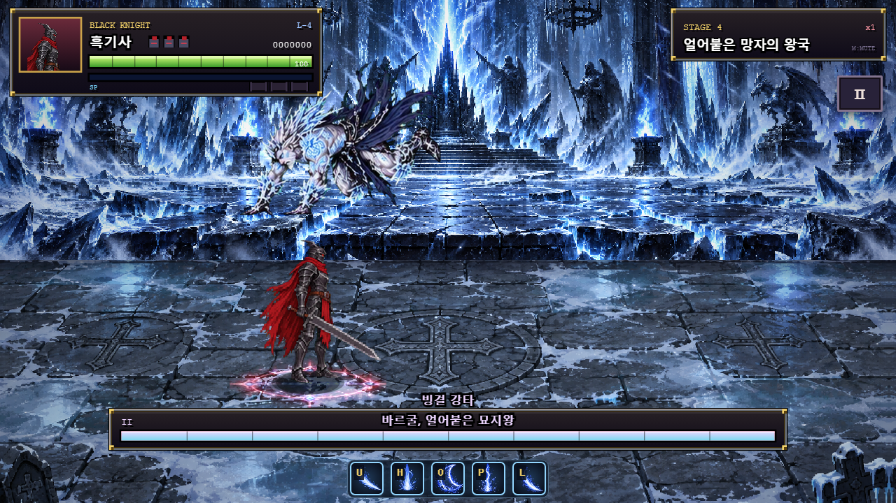
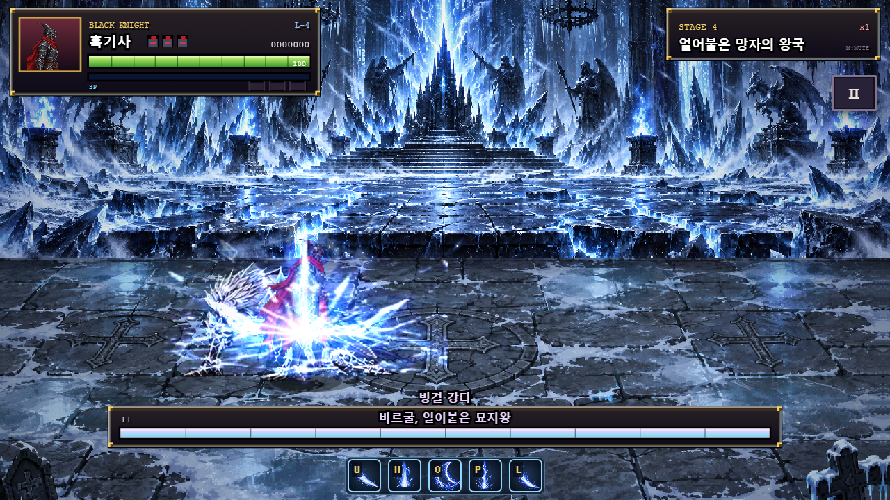
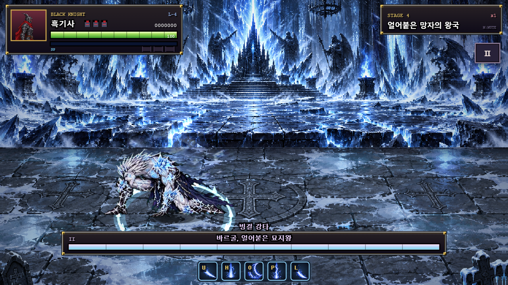

# 바르굴 궁극기 — 빙결 강타

2026-10-21 (Asia/Seoul). 공중에 오른 뒤 거대 창을 던지던 궁극기를 바르굴 본체의 고속 강하·지면 강타·확장하는 빙결파로 변경했다.

## 동작과 판정

| 구간 | 기술 시작 기준 τ | 동작 |
| --- | --- | --- |
| 시동 | 0–25 | 흰 예고·슈퍼아머 |
| 도약 | 26–44 |19틱 동안 높이240까지 상승 |
| 공중 추적 | 45–104 | 화면 위에서 무적, 착지 표식은 플레이어 추적 |
| 고정 예고 | 105–134 | 표식 고정, 탈출 시간30틱 |
| 고속 강하 | 135–140 | 바르굴 본체가6틱 동안 고정 지점으로 강하, 보이며 무적 |
| 지면 강타 | 141–148 | 착지 중심 타원 피해30·넉다운, 판정8틱 |
| 빙결파 | 149–184 | 중심에서 타원형 파면이36틱 동안 바깥으로 확장, 피해13·넉다운 |
| 착지 정리 | 149–159 | 보스는 충돌 지점에 남아 자세 정리 |
| 반격 시간 | 160–249 | 무릎 꿇기90틱, 실제 피해를 받을 수 있음 |
| 마무리 | 250–267 | 기존 회복 모션18틱 |

궁극기 키`ultimate`·2페이즈 체력35% 첫 사용·쿨타임900·전체268틱은 유지했다. 표시 이름은 “빙결 강타”다. 원본 아트는 다시 처리하지 않고 기존 도약·강하·무릎 그림을 사용한다. 본체와 문신의 크기 보정도 유지한다. 공중에 있을 때 서리 오라도 본체 높이를 따른다.

착지 중심은 x반경56.232·깊이34다. 기본23에 공통P2배율을 적용해30피해다. 이전처럼 착지와 동시에 넓은 외곽 전체를 때리지 않는다.8틱 뒤 별도의 빙결파가 시작한다.

빙결파의 최대 반경은 x102.24·깊이61.818이다. 파면 두께는 기준 반경 양옆6이며 한 틱의 이동 구간까지 포함해 판정한다. 보이는 띠의 안쪽·바깥쪽 경계와 판정이 같은 데이터를 사용한다. 한 번 지나간 내부는 안전하고 같은 파도가 반복 피해를 주지 않는다. 기본10→13피해, 플레이어 높이10.224 이하는 피격하며 그보다 높으면 점프로 넘는다. 새 빙결 상태이상은 추가하지 않고 기존 피해·넉다운 처리를 쓴다.

공략은 **고정 중심에서 이탈한 뒤, 착지 이후 밀려오는 파면에 맞춰 점프하고 반격**하는 것이다. 기존3단계의 충돌 전 점프 성공 범위는 변경 전 기록이다.

## 실제 실행 검증

격리 Chrome에서 제품의`update()`·입력·보스 상태 머신·피격 함수를 실행했다. [원본 결과](../artifacts/vargul-1.36/ultimate-slam/results.json), [시험 코드](../tests/vargul-ultimate.cjs).

- 도약19틱의 상승, 보이는6틱 강하, 고정 표식 위치로의 실제 착지를 확인했다.
- 공중과 강하 중 실제 피해를 넣어도 보스HP가 줄지 않고, R 시작 후에는 피해가 들어간다.
- 착지 중심 피해30이 정확히8틱의 활성 구간을 가진다.
- 빙결파는149틱에 한 번 생성되고36틱 동안 반경이 단조 증가해 최대102.24에 도달한다.
- 지상 x거리25/60/95의 실제 첫 피해는 파도 생성 기준6/19/31틱이었다. 모두13피해이고 x거리120에서는0피해다. 동시 광역 판정이 아니라 파면의 도달 순서대로 맞는다.
- 거리80에서 실제 점프 버퍼 입력을0–26틱 지연해 검사했다.0–24틱 입력은 무피격,25–26틱은13피해였다. 이 값은 해당 거리의 파도 생성 기준 시험이다.
- 궁극기 전체를 시작해 표식 고정 후 x65 이상 걷고160틱째 점프하는 동선도 실제 무피격으로 완료했다.
- 무릎 꿇기R90·전체268틱과 사망 시 남은 빙결파 정리를 확인했다.
- 전용14개 기술·디버그 반복·등장·전환·사망 회귀 통과. [전용 회귀](../artifacts/vargul-1.36/ultimate-slam/regression/results.json).
- 전체72개 보스 기술/페이즈·1–5스테이지 클리어 회귀 통과. 콘솔 오류·브라우저 예외0. [전체 로그](../artifacts/vargul-1.36/ultimate-slam/full-regression.log).







## 변경 파일과 재현

제품 변경은`vargul-data.js`의 궁극기 구간·파도 수치, `vargul-runtime.js`의 본체 이동·착지·파면 판정과 연출이다. 기존`tests/vargul.cjs`의 외곽 판정 기대값을 확장파 검사로 바꾸고 전용 실행기를 추가했다. 기준 문서·README·패치 노트도 갱신했다. 이번 변경에서 처치 비교·60초 성능은 다시 측정하지 않았다.

```powershell
$env:VARGUL_ULTIMATE_SUITE='1'
node tests/regression.cjs
Remove-Item Env:VARGUL_ULTIMATE_SUITE
$env:VARGUL_SUITE='1'
$env:VARGUL_ARTIFACT_DIR='artifacts/vargul-1.36/ultimate-slam/regression'
node tests/regression.cjs
Remove-Item Env:VARGUL_SUITE
$env:VARGUL_CAPTURE_CONSOLE='1'
node tests/regression.cjs
```
