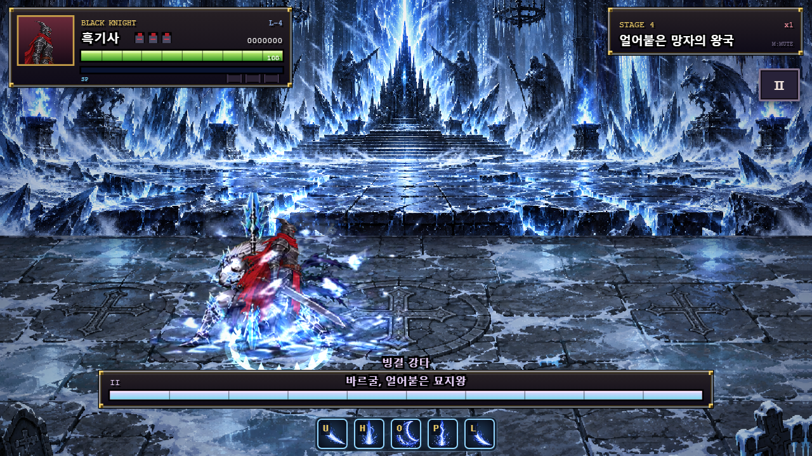
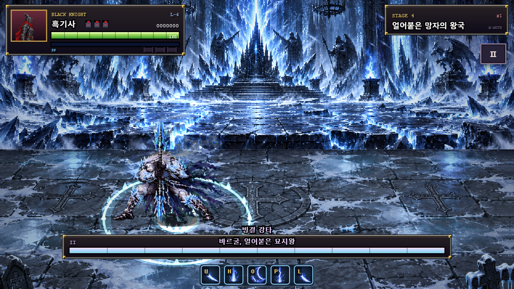

# 바르굴 궁극기 — 창 내려찍기·연속 빙결파

2026-10-21 (Asia/Seoul). 궁극기의 착지를 창으로 바닥을 찍는 동작으로 바꾸고, 창을 꽂은 채 빙결파를 연속으로 퍼뜨리도록 변경했다. 이전 [단일 파동 보고서](boss4_vargul_ultimate_slam_report.md)는 변경 전 기록으로 보존한다.

## 적용

| 항목 | 변경 후 |
| --- | --- |
| 강하135–140틱 | `p2_cast`7→8장으로 창 내려찍기 |
| 착지141–159틱 | `p2_cast`8장, 창을 바닥에 꽂은 자세 |
| R160–249틱 | `p2_cast`9–11장, 창을 꽂고 집중하는 자세90틱 |
| 빙결파 생성 |149/173/197틱, 착지 후8/32/56틱 |
| 각 파동 |36틱 확장, 마지막 파동은232틱까지 |
| 피해 | 중심30, 각 파동13 |

기존 시트에서 실제로 창을 바닥에 꽂는 그림을 연결했다. 캐릭터·문신 크기 보정과 발 피벗을 유지하고 원본 아트를 새로 처리하지 않았다. 착지점에 짧은 창끝 섬광을 추가했다.

빙결파는 같은 충돌 지점에서24틱 간격으로3겹 나간다. 이전 파동이 사라지기 전에 다음 파동이 나와 여러 겹이 겹쳐 보인다. 각 파동은 최대 x102.24·깊이61.818까지 바깥으로 확장하며 지나간 내부는 안전하다. 낮은 파면은 높이10.224를 넘는 점프로 회피할 수 있다.

중심8틱 판정·파동마다 한 번 피격하는 규칙·공통 피격 무적·다운을 유지했다. 전체268틱, 첫35% 사용, 쿨타임900, R90도 유지했다. R 중에도 파동이 남아 있으므로 이어지는 파동을 읽으면서 반격해야 한다.

## 실제 검증

[실행 원본](../artifacts/vargul-1.36/ultimate-spear/results.json), [시험 코드](../tests/vargul-ultimate.cjs). 실제 Chrome에서 제품의`update()`·입력·피격 함수를 실행했다.

- 강하와 충돌에 연결된 실제 그림이`p2_cast`7–8장인지 검사했다. 충돌 시8장이며249틱까지 창을 꽂은8–11장 구간이 유지된다.
- 파동3개가 정확히149/173/197틱에 생성됐다. 각각36개 업데이트 동안 반경이 증가해 최대값에 도달했다.
- 서로 다른 두 파동이 함께 존재하는 구간을 확인했다.233틱에는 마지막 파동도 사라졌다.
- 중심30·파동13피해, 안쪽에서 바깥쪽으로 차례로 도달하는 판정, 범위 밖 무피격을 검사했다.
- 궁극기 전체에서 표식 중심을 벗어나고 실제 점프를 두 번 입력하는 제어로3겹 파동 전체를 무피격으로 완료했다. 일반적인 모든 위치의 자동 회피를 보장하는 뜻은 아니다.
- 공중·강하 무적, R90 중 실제 피해 허용, 사망 시 파동 정리를 검사했다.
- 전용14개 페이즈별 기술·디버그 반복·등장·변신·사망 회귀 통과. [전용 회귀](../artifacts/vargul-1.36/ultimate-spear/regression/results.json).
- 전체72개 보스 기술/페이즈·1–5스테이지 클리어 회귀 통과. 콘솔 오류·브라우저 예외0. [전체 로그](../artifacts/vargul-1.36/ultimate-spear/full-regression.log).





제품 변경은`vargul-data.js`의 그림 대응·파동 개수/간격, `vargul-runtime.js`의 연속 파동 생성·착지 섬광이다. 기준 문서·README·패치 노트를 갱신했다. 이번 변경에서 처치 비교·60초 성능은 다시 측정하지 않았다.

```powershell
$env:VARGUL_ULTIMATE_SUITE='1'
node tests/regression.cjs
Remove-Item Env:VARGUL_ULTIMATE_SUITE
$env:VARGUL_SUITE='1'
$env:VARGUL_ARTIFACT_DIR='artifacts/vargul-1.36/ultimate-spear/regression'
node tests/regression.cjs
Remove-Item Env:VARGUL_SUITE
$env:VARGUL_CAPTURE_CONSOLE='1'
node tests/regression.cjs
```
