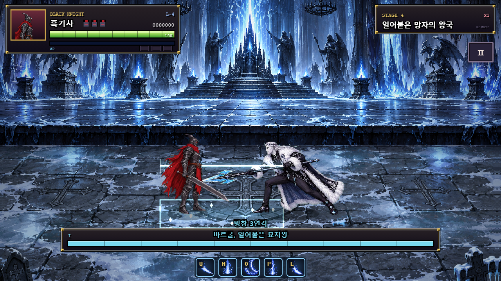
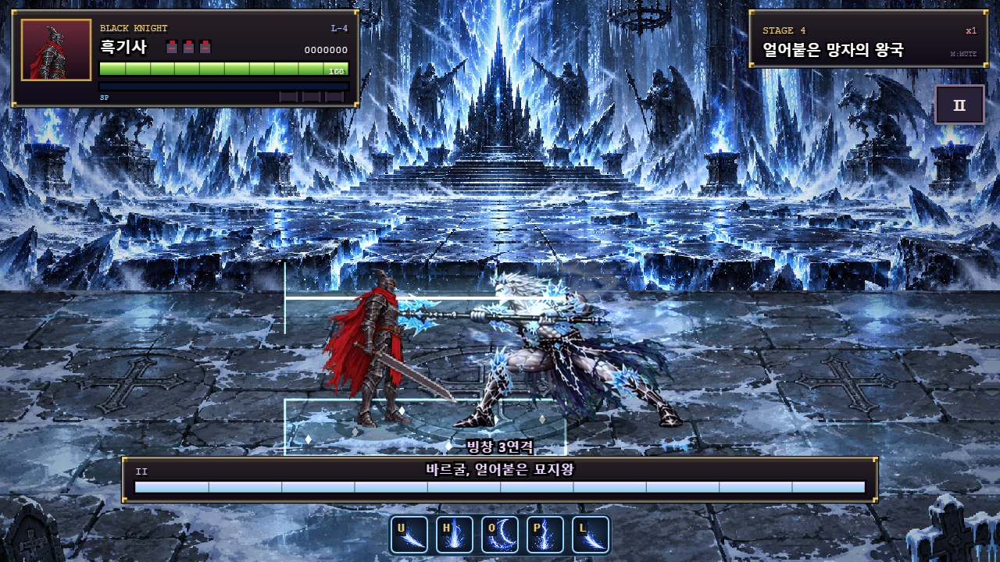

# 바르굴 패턴 크기 안정화·3연격 이펙트

일부 공격 자세가 커 보이는 현상을 보정하고 두 페이즈의 3연격에 공격 범위 이펙트를 추가했다.

## 크기 보정

기존 아틀라스는 그림마다 캐릭터의 세로 길이를 기준으로 크기를 맞췄다. 몸을 낮추거나 옆으로 기울인 프레임을 같은 높이로 늘리면서 몸통이 커졌다. 예를 들어 P1 십자 집중 그림은 대기 그림보다 캐릭터 픽셀 면적이 약5.51배였다. 이는 높이가5.51배라는 의미가 아니다.

창·청록 냉기 픽셀을 제외한 캐릭터 영역을 측정하고, 각 페이즈 대기 그림의 중간값을 기준으로 `min(1, sqrt(대기 면적/프레임 면적))`의 렌더 배율을 만든다. 작은 자세를 확대하지 않고 과하게 큰 자세만 줄인다. 발을 기준으로 그리므로 축소에 따라 바닥 위치가 움직이지 않는다. 문신 마스크에도 동일한 배율을 적용한다.

측정은 빌드 도구에서 한 번 실행하며 게임 프레임마다 이미지를 분석하지 않는다. 왕좌 등장과 사망 잔해의 구성은 그대로 둔다. 자세·옷자락 모양 자체를 같게 만드는 방식은 아니며, 공격 자세에서 발생한 과대 확대를 제한한다. 원본 시트·`vargul-art.js`·아틀라스·프레임 메타데이터는 수정하지 않았다.

## 3연격 효과

- 다음 타격 전8틱 이내: 옅은 냉기 띠로 다가올 바닥 범위를 표시한다.
- 활성 틱: 밝은 창 궤적·얼음 가루·바닥 범위를 표시한다.
- 이펙트는 현재 공격의 `vargulAttackBox`와 깊이18을 직접 사용한다. 실제 공격 높이와 x범위를 따라가며 좌우 방향을 반영한다.
- 1·2·3타 각각과 두 페이즈 모두 적용한다. 시동 표시 자체에는 공격 판정이 없고 후딜에는 표시하지 않는다.
- 피해·공격 사거리·판정 시작/종료 틱은 바꾸지 않았다. 줄을 바꿔 피해야 하는 실제 범위를 읽을 수 있게 했다.





## 검증

- [실행 결과](../artifacts/vargul-1.36/visual-fix/results.json): 실제 Chrome에서14개 페이즈별 기술의1,612개 타임라인 슬롯을 그렸다. 모든 캐릭터 렌더 배율이 원래 배율 이하이며 문신도 같은 배율을 사용한다.
- 공격 동작에서 측정한 캐릭터 면적의 제곱근 비율 최대값은 대기 대비2.347→1.000으로 제한됐다. 면적 기준의 시각 크기 지표이며 실제 키 측정값과 구별한다.
- P1/P2 각3타의 활성 틱마다 이펙트 데이터가 실제 공격 상자·깊이와 같은지 검사했다. 양쪽 방향에서 범위 중심에 실제 피격 판정이 생기는지도 확인했다.
- 시동 표시48틱을 검사하고 후딜·추격에 공격 범위가 남지 않는 것을 확인했다.
- 전용14개 기술·디버그 반복·등장·변신·사망 회귀 통과. [전용 회귀](../artifacts/vargul-1.36/visual-fix/regression/results.json).
- 전체72개 보스 패턴/페이즈·1–5스테이지 클리어 회귀 통과. 콘솔 오류·브라우저 예외0. [전체 로그](../artifacts/vargul-1.36/visual-fix/full-regression.log).
- P1/P2의 각 타와 십자 집중 장면을 캡처해 화면으로 확인했다. 이번 변경에서 처치 시간·60초 성능 측정은 다시 하지 않았다.

## 파일과 재현

제품 변경: `vargul-data.js`의 프레임별 시각 배율, `vargul-runtime.js`의 배율 적용·3연격 효과. `tools/measure_vargul_visual.py`는 기존 아틀라스를 읽어 배율 데이터만 갱신한다. `tests/vargul-visual.cjs`와 기존 브라우저 실행기에 전용 검증을 추가했다. 기준 문서·README·패치 노트도 갱신했다.

```powershell
python tools/measure_vargul_visual.py
$env:VARGUL_VISUAL_SUITE='1'
node tests/regression.cjs
Remove-Item Env:VARGUL_VISUAL_SUITE
$env:VARGUL_SUITE='1'
$env:VARGUL_ARTIFACT_DIR='artifacts/vargul-1.36/visual-fix/regression'
node tests/regression.cjs
Remove-Item Env:VARGUL_SUITE
$env:VARGUL_CAPTURE_CONSOLE='1'
node tests/regression.cjs
```
