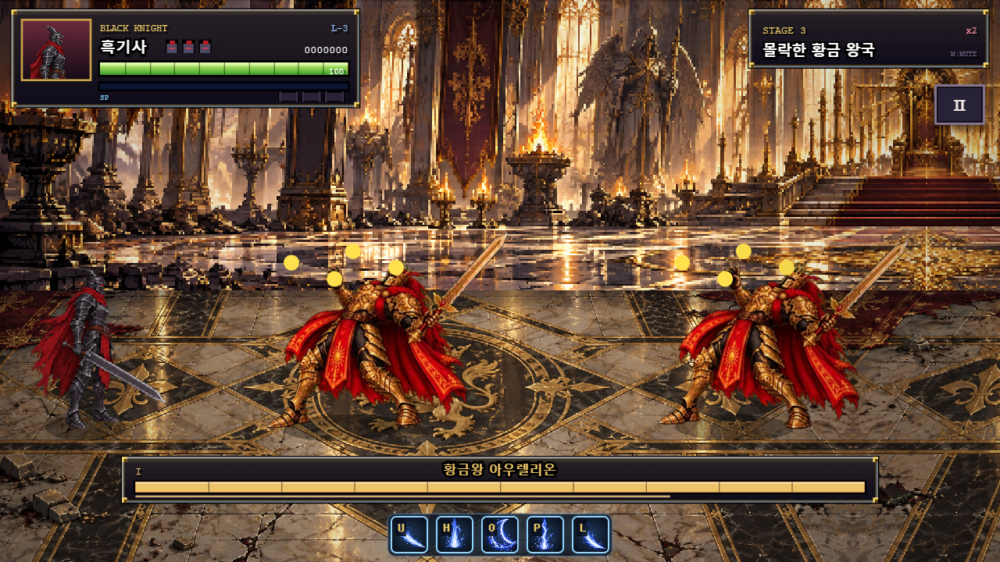
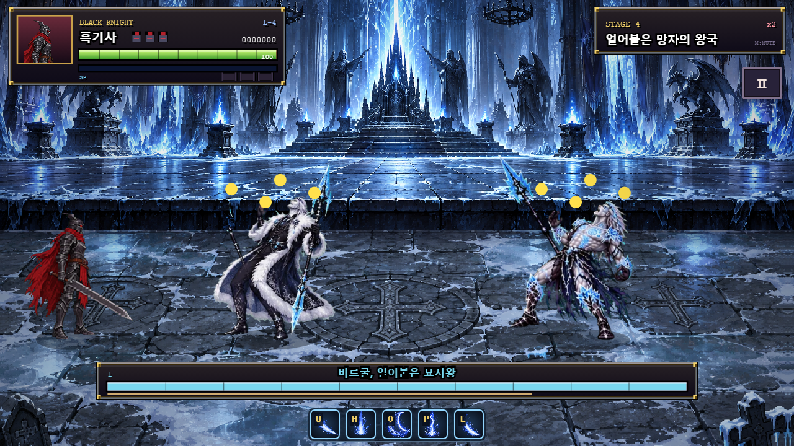

# 모든 보스의 그로기 — 서서 비틀거리는 자세

2026-10-21 (Asia/Seoul). 1–5스테이지 보스가 그로기일 때 서 있는 자세로 비틀거리도록 변경했다.

## 변경

| 보스 | 그로기 그림 |
| --- | --- |
| 고라스 | 서 있는 초기 피격 그림 |
| 모르그라 | P1/P2의 서 있는 피격 그림 |
| 아우렐리온 | 다운 대신 서 있는 피격 그림 |
| 바르굴 | P1/P2 피격 시트의 첫 서 있는 그림 |
| 블랙 문 엠페러 | P1 대기 자세 / P2 날개를 펼친 서 있는 자세 |

모든 보스 렌더러에 발을 축으로 한 작은 좌우 흔들림을 공통 적용했다. 회전은 그리기에만 사용하므로 보스의 월드 위치·줄·물리 높이를 이동시키지 않는다. 그로기 타이머로 움직이므로 일시정지·히트스톱 중에도 임의로 흔들림이 진행되지 않는다. 기존 머리 위 기절 표시는 유지한다.

그로기 상태 키`stun`, 지속300틱(5초), 받는 피해1.5배, 공격받을 수 있는 상태, 종료 후 회복 처리는 그대로다. 다운·사망·변신 그림을 바꾸지 않았으며 체력 문턱의 강제 다운은 계속 쓰러지는 동작으로 처리한다. 아우렐리온·바르굴의 피격 상자는 기존 방식대로 선택한 서 있는 그림을 기준으로 갱신된다.

## 검증

[실행 원본](../artifacts/boss-groggy-standing/results.json), [시험 코드](../tests/boss-groggy.cjs). 실제 게임 코드를 Chrome에서 실행했다.

- 보스5종×두 페이즈10개 경우 모두 실제 그로기 게이지를 채워`stun`에 진입시켰다.
- 다운 그림 대신 위의 서 있는 그림이 선택되고, 발 기준 회전이 시간에 따라 달라지는 것을 확인했다.
- 그리기 전후 월드 위치·높이가 같고 Canvas save/restore가 균형을 유지한다.
- 모든 경우 일반 피해10이 그로기 중15가 되며 상태를 끊지 않는다.
- 정확히300틱 뒤 회복 상태로 넘어가고 그로기 게이지가 초기화된다. 기절 중 무적이 생기지 않는다.
- 모든 경우 실제 체력 문턱 타격은 여전히`down`으로 진입한다.
- 레거시HD 보스5종의 그로기용 서 있는 프레임이 존재하는 것도 검사했다.
- 다섯 보스의 P1/P2를 나란히 렌더링해 화면으로 확인했다.
- 전체72개 보스 기술/페이즈·1–5스테이지 클리어 회귀 통과, 콘솔 오류·브라우저 예외0. [전체 로그](../artifacts/boss-groggy-standing/full-regression-final.log).





## 파일과 재현

`game.js` 공통 비틀거림·레거시HD 프레임, 각 보스 런타임의 그로기 그림 선택, `named-runtime.js` 최종 보스 서 있는 자세를 수정했다. 원본 그림은 재처리하지 않았다. README·바르굴 기준 문서·패치 노트에 공통 규칙을 반영했다.

```powershell
$env:BOSS_GROGGY_SUITE='1'
node tests/regression.cjs
Remove-Item Env:BOSS_GROGGY_SUITE
$env:VARGUL_CAPTURE_CONSOLE='1'
node tests/regression.cjs
```
